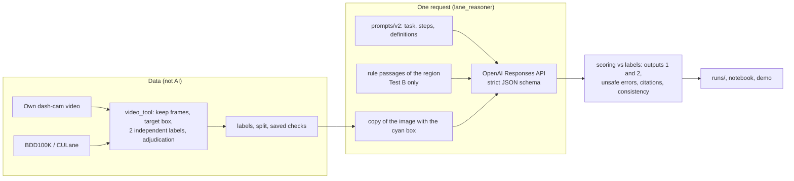

# Reasoning Driving

EGN 6216 AI Systems, Fall 2026. Jiahao Pang, University of Florida.

Research question: does the local traffic-rule text help a multimodal LLM read lane markings in different regions?

Lane markings mean different things in different countries, and a lane detector only finds where the lines are, not what they allow. This project asks a multimodal model (OpenAI `gpt-6.1-sol`) what one marked lane marking in a dash-cam photo allows a car to do. Each image is asked twice: Test A with the image only, and Test B with the image plus the rule passages of the photo's region (MUTCD for the US, GB 5768.3-2025 for China). Everything else is the same, so the difference shows what the rule text adds. No region-specific model is trained, and the answers cite the rule they use, so they can be checked.

## Status (27 Oct 2026)

| Stage | Status | Where |
|---|---|---|
| Data collection (Milestones 2 and 3) | BDD100K validation split (10,000 images), CULane test split (34,680 frames), MUTCD Part 3 and GB 5768.3-2025; every download hashed | [`playground.ipynb`](playground.ipynb), [docs/data_collection.md](docs/data_collection.md), `data_manifest.csv`, `data_hashes.csv` |
| Rule pack | 30 passages (16 US, 14 CN) with ID, section and page; a rule table that keeps the labels consistent | `rules/rule_passages.json`, `config/action_rules.json` |
| Labels (pilot) | 40 final labels from my own Florida night drive, two independent annotators plus adjudication; BDD100K: 5 images picked, not labeled yet; CULane: none yet | [`video_tool`](docs/labeling_tool.md), `labels/` |
| Splits and checks | split v1 (Milestone 3 rule), then v2 (pilot drive moved to development, reason logged); separation check and clip counts saved with each version | `labels/split_v*.csv`, `split_check_v*.json`, `coverage_v*.csv`, `split_changes.csv` |
| Model runs (Milestone 4) | 4 runs on the development images (Test A and B, prompt v1 and v2, 3 repeats each), real API | [`model_exploration.ipynb`](model_exploration.ipynb), `runs/` |
| Demo | browser page: pick an image, see the exact prompt, ask Test A and B, compare runs | `python -m lane_reasoner demo` |
| Test set | not run yet (see *Not done yet*) | |

## Results so far (Milestone 4, development images only, preliminary)

40 development images from one US night drive, every target fully visible. Each image was asked 3 times and the majority answer is scored. Output 2 counts only the actions the label decides; contested rule-table cells are left out (37 images have actions that count).

| Run | Configuration | Output 1 (marking) | Output 2 (actions) | Unsafe errors | Inconsistent answers | Same answer in all 3 repeats | Cost |
|---|---|---|---|---|---|---|---|
| 1 | Test A, prompt v1 (initial) | 40/40 | 36/37 | 1 | 6 | 82.5% | $0.51 |
| 2 | Test B, prompt v1 (the targeted change: add the rule passages) | 39/40 | 35/37 | 0 | 7 | 80.0% | $0.77 |
| 3 | Test A, prompt v2 | 39/40 | 35/37 | 1 | 0 | 90.0% | $0.82 |
| 4 | Test B, prompt v2 | 40/40 | 36/37 | 0 | 0 | 97.5% | $1.22 |

Run IDs: `20261027_021643_testA_US`, `20261027_021740_testB_US`, `20261027_021835_testA_US`, `20261027_021957_testB_US`. Costs count only requests that were not answered from the cache (runs 1 and 2 reused 40 identical requests made on 22 Oct). Mean latency was 4.1 to 4.8 s per request (p95 7.3 to 8.0 s), with 2,100 to 4,000 input tokens and about 220 output tokens per request.

* The rule text removed the one unsafe error type. On a single solid yellow line at the left edge of a divided road, Test A allows crossing; Test B cites MUTCD 3B.09 ¶03 and prohibits it. Accuracy did not change: the exact McNemar p is 1.0 for every pair of runs, and at most 3 of 37 images differ between any two runs.
* Prompt v2 removed the answers that contradict themselves (from 6 or 7 per run to 0) and made the answers more stable (identical over three repeats on 90% and 97.5% of the images, up from 82.5% and 80%). Accuracy stayed the same and each request costs 5 to 8% more.
* Two cases are open for review: the faint edge line `f0008220` (both v2 runs say it is hard to see, the label says fully visible), and the contested U-turn from a left-turn lane (with v2, Test A answers *allowed* 7 of 7 times, Test B *prohibited* 6 of 7 times, citing 3B.23-01).
* The difference between A and B is small because the images are easy, come from one drive, and come from the region the model knows best. The research question needs clip-separated images from both regions (see *What the results can and cannot claim*).

All numbers, the error cases with image crops, and the reason for each change are in [`model_exploration.ipynb`](model_exploration.ipynb), saved with outputs.

## Reproduce

There are three levels, from no data at all to the full pipeline. The self-tests pass on macOS (Apple silicon, Python 3.11) and on Linux (Python 3.10 and 3.13).

### Level 1: no data, no API key (about 10 minutes)

```bash
git clone https://github.com/Jonas-Pang/Reasoning-drive.git && cd Reasoning-drive
conda create -n reasoning-driving -c conda-forge --override-channels python=3.11 -y && conda activate reasoning-driving
pip install -r requirements.txt     # inside the activated environment, not in conda "base"

python -m video_tool selftest       # 32 checks: labeling tool on a synthetic night video and two tiny synthetic datasets
python -m lane_reasoner selftest    # 36 checks: prompts, schema, scoring, mock runs, a fake OpenAI server, demo, key never in a file

# the Milestone 4 numbers, recomputed from the saved runs (runs/ is in Git; no images or key needed)
python -m lane_reasoner table 20261027_021643_testA_US 20261027_021740_testB_US 20261027_021835_testA_US 20261027_021957_testB_US
python -m lane_reasoner compare 20261027_021643_testA_US 20261027_021740_testB_US
python -m lane_reasoner rescore 20261027_021957_testB_US   # scores the saved answers again with the current scoring code
```

Use Python 3.11 in its own environment. `requirements.txt` pins exact versions, and on a much newer Python (for example an up-to-date conda `base`) some of them have no ready-made wheels, so pip fails while trying to build matplotlib.

### Level 2: public datasets and your own API key

1. Data. Open `playground.ipynb` and run all cells. It downloads BDD100K (mirror) and MUTCD, checks the five CULane archives you download in the browser (Google Drive blocks scripted downloads; the notebook names the files), unpacks them and writes `data_manifest.csv`. Then record the hashes:
   ```bash
   python -m video_tool hash-sources            # SHA-256 and MD5 of every download, into data_manifest.csv and data_hashes.csv
   ```
   Compare with `data_hashes.csv` in this repository to confirm you have the same files. Keep the data outside the repository or in `data/` (ignored by Git), and set `DATA_DIR` in `.env` if it is elsewhere.
2. Workspaces and labels. One folder per collection, all under one root (mine is `/Volumes/T9/数据集`):
   ```bash
   python -m video_tool --data "<root>/bdd100k" images init bdd100k    # candidate index; pools by the 6.5 hash rule
   python -m video_tool --data "<root>/culane"  images init culane
   python -m video_tool --data "<root>/bdd100k" label                  # pick, label, adjudicate, share with helpers
   ```
   The labeling procedure (two independent labels, offline helper packages, adjudication, guide) is in [docs/labeling_tool.md](docs/labeling_tool.md). Labels are always made by people, never by a model.
3. Combine, split and check:
   ```bash
   python -m video_tool combine "<root>/UF" "<root>/bdd100k" "<root>/culane"
   ```
   This writes `labels/labels.csv`, `labels/split_v<N>.csv`, the separation check `labels/split_check_v<N>.json`, the clip-separated counts `labels/coverage_v<N>.csv` and `labels/candidate_supply.csv`.
4. Settings. In `.env` (copy `.env.example`) set `DATASETS_ROOT=<root>`; the API key is added in the next step. `config/experiment.json` holds the model and its settings, `data_policy.send_to_api` (which collections may be sent to the API, see *Data sent to the API*), the prompt version and the regions.
5. API key and a first request. Run Section 1 of `experiment.ipynb` (hidden input box; it writes only `.env`), then
   ```bash
   python -m lane_reasoner ping --real          # one tiny request: key, model name, settings
   ```
   If the model rejects a setting, the error message names it (for `gpt-6.1-sol`, `reasoning_effort` must be at least `low` and `temperature` is not accepted).
6. Runs. Run all cells of `model_exploration.ipynb` (development images, 3 repeats, Test A and B, prompt v1 and v2; matching finished runs are reused), or use the command line:
   ```bash
   python -m lane_reasoner run --test AB --split dev --repeats 3 --real
   ```
7. Demo: `python -m lane_reasoner demo`, then switch on *Real API* on the page.

### Level 3: the own-video development set

The 40 development images come from my own dash-cam drive. The frames are not in the repository because they show other people's vehicles; the labels, the split and the model answers are. To rebuild the same development set you need the video (available on request for course review) and `python -m video_tool rebuild`, which first checks the video's SHA-256 in `labels/own_video/*.trip.json`. You can also record your own drive and label it with `video_tool` (ingest, scan, label, package, import, export).

What to commit after a run: `labels/`, `runs/<run_id>/` (no images and no key; `runs/cache/` and mock runs are ignored), the notebook with outputs, `data_manifest.csv` and `data_hashes.csv`. Never `.env`.

## How the system works



| Part | AI? | What it does | How it is tested |
|---|---|---|---|
| Frame keeping, target box, labels | no | people label marking type, visibility, six actions and accepted rule IDs; the rule table fills in consistent defaults | agreement (Fleiss κ), adjudication, label checker |
| Prompt builder | no | fixed templates plus the region's passages (Test B); never reads labels | self-test: Test A has no passage, Test B has exactly the region's passages, shared parts identical |
| Image preparation | no | draws the cyan box on a copy and encodes it as JPEG | self-test: box position, original unchanged |
| Model | yes | interprets the marking: type, arrow directions, position, evidence level, six actions, cited passage | Milestone 4 runs |
| Parser and schema | no | strict JSON schema; unreadable answers are counted, not repaired | self-test with malformed answers |
| Scoring | no | compares with the labels; contested cells kept separate; McNemar test | self-test with known answers |
| Policy, retries, cache | no | only permitted collections are sent; retries on 429 and 5xx; identical requests answered from the cache | self-test with a fake API server |

The answer format is the same in both tests. The fields are `description`, `evidence` (full, partial or insufficient), `marking` (Output 1: type, arrow type, position), `actions` (Output 2: cross line, go straight, turn left, turn right, U-turn, enter centre lane; each allowed, prohibited, not_determined or not_applicable), `cited_rule_id` (Test B) and `reasoning`. With a strict schema the model writes the fields in this order, so it describes what it sees before it decides.

### Prompt design against hallucinations (ideas from DiLu)

DiLu builds a driving agent from reasoning (describe the scene, then decide), memory (stored knowledge and past experience put into the prompt) and reflection (correct wrong decisions and keep the corrected experience). This project keeps the images fixed and measures the effect of the rule text, so the three ideas are used as follows.

| DiLu module | In this project | Hallucination it targets |
|---|---|---|
| Reasoning | Four steps: look (visible features only; never infer colour or arrow direction from position), match the rule, decide only the actions this marking governs, check. The field order puts the description first | deciding before looking; inventing features |
| Memory | Test B gives the region's passages with IDs and says "use the passages, not memory"; only listed IDs may be cited, and this is checked automatically. Fixed text examples are planned, written only from a separate pool of development images and identical in A and B | invented rules and invented citations |
| Reflection | Offline and only on development images: the errors of runs 1 and 2 led to prompt v2 (governed actions per marking class, turning left out of a two-way left-turn lane, `not_determined` only with partial evidence, a self-check step). Test images never change the prompt | answers outside the task definition |

Other measures: a closed vocabulary (strict schema), abstention through the evidence level, three repeats with a majority vote, and a consistency check that needs no labels (`scoring.consistency_issues`) and flags answers that contradict themselves. Its count is the hallucination indicator reported for every run: 6 to 7 per run with v1, 0 with v2. Details are in [`prompts/v2/README.md`](prompts/v2/README.md).

### Metrics

* Output 2 exact match (main metric): every action the label decides is right. Unsafe errors: the label prohibits and the model allows. Precision, recall and F1 of "prohibited" over all (image, action) pairs.
* Output 1: accuracy, per-class precision, recall and F1, macro-F1, confusion matrix.
* Evidence groups (correct, wrong, unsupported guess, appropriate withholding, over-withholding), citations (accepted, in the pack but not accepted, not in the pack, none, none needed), confidently wrong answers, inconsistent answers.
* Repeatability (same answer in all repeats), readable answers, latency, tokens and cost, against the Milestone 3 targets in 2.1 (readable ≥ 95%, a full run under 1 h, total cost under $50, repeatability ≥ 90%).
* Exact McNemar test on the images both runs answered.

## Data, labels and splits

### Sources and hashes

Eight downloads (19.8 GB): the BDD100K mirror archive, five CULane archives, MUTCD Part 3 and GB 5768.3-2025. For each, `data_manifest.csv` and `data_hashes.csv` record origin, retrieval date, licence, size, SHA-256 and MD5. The BDD100K archive is a mirror (Dataset Ninja) of the official release; no official checksum is published, so only its own hash is recorded. The own video's SHA-256 is in its trip file.

### Pilot labels and their uncertainty

142 frames were kept from one night drive (17 Oct 2026, Florida): 40 have a final label, 4 wait for adjudication and 98 have no target box yet. Of the 40, both annotators agreed on 39 and 1 was adjudicated; 38 are fully visible and 2 partly visible (V1). Agreement before adjudication (43 double-labeled frames, Fleiss κ): marking type 1.00, arrow type 1.00, position 0.92, visibility 0.79, cross line 0.96, turn left 0.95, other actions 1.00 (`labels/own_video/agreement.csv`).

### How many clip-separated examples exist

From `labels/coverage_v2.csv`: US, development: yellow double solid 15, white dashed 7, left arrow 5, yellow solid 4, straight arrow 3, two-way left-turn lane 2, other 2, white solid 1, straight-and-left arrow 1. All of them come from one drive, so every type has one clip so far. China: none yet. What the datasets can still supply (`labels/candidate_supply.csv`; candidates, not labels):

| Source | Pool | Lines (examples) | Arrows |
|---|---|---|---|
| BDD100K (one clip per image) | dev / test | white solid 497 / 4,358; white dashed 516 / 4,631; yellow double solid 211 / 1,846; yellow solid 142 / 1,181 | no arrow label (found by eye only) |
| CULane (≤ 2 test frames per clip) | dev / test | categories, not line types (e.g. normal 833 frames in 24 clips / 8,788 in 291 clips) | `arrow` category: 90 frames in 17 clips / 800 frames in 208 clips |

### Which arrow types the data supports

US: left and straight (own video; BDD100K has no arrow labels), and straight-and-left with a single example. Right-turn and U-turn arrows have no examples and are not claimed. China: decided after labeling the CULane arrow frames, because the category does not give directions. A type with fewer than 15 clip-separated test images is reported separately or dropped (Milestone 3 trigger).

### Splits and separation (6.5)

The hash rule (a clip goes to development if `sha1("6216:"+clip) mod 10 = 0`) sets the BDD100K and CULane pools. Split v1 kept the own drive in the test set. On 22 Oct the drive was used to build and demo the prompts before `split_v1.csv` existed, and its answers and errors were looked at, so on 27 Oct the whole drive was moved to development (`labels/split_changes.csv` with the reason; `split_v2.csv`; v1 kept). The BDD100K and CULane test pools have never been sent to the model. Each version's `split_check_v<N>.json` records clips on both sides (0), development/test pairs within 4 bits dHash across all workspaces (0), prompt examples not from development images (0; there are no examples yet) and every move. `model_exploration.ipynb` asserts that its runs use development images only.

## Data sent to the API, licences and privacy

The system runs in batches, not in real time, and needs the internet: it sends data to OpenAI. Each request contains one JPEG copy of the image with the target box, the instructions and, in Test B, the region's rule passages, sent over HTTPS to the OpenAI Responses API. Labels, notes and file names are not sent. Requests use `store: false`. Under OpenAI's current API data policy, API data is not used to train models unless the owner opts in, abuse-monitoring logs are kept for up to 30 days, and uploaded images are scanned for illegal content ([OpenAI: Your data](https://developers.openai.com/api/docs/guides/your-data)).

* Own video: my footage, sent as recorded (other vehicles appear at night and at a distance; no privacy boxes were drawn on the 40 frames). Notebook figures show only crops around the target.
* BDD100K and CULane: their licences allow non-commercial research but say nothing about sending images to an external API. I do not treat that as permission, so `data_policy.send_to_api` stays `["own_video"]` until the owners confirm in writing. The request drafts and their status are in [docs/permission_requests.md](docs/permission_requests.md). CULane images are not saved in any notebook in this repository (no redistribution).
* API key: read only from `OPENAI_API_KEY` in `.env` (ignored by Git). Runs, notebooks and settings record only whether a key was set, and the self-test checks that a key never ends up in a file.

## What the results can and cannot claim

Using the same images in Test A and Test B controls the image, not everything else.

* Pretraining exposure may interact with the rule text. If the model has seen the public images or memorised the MUTCD, Test A is already high and Test B can add little. This is not the same for both tests or for both regions. The own video was never public, which gives a within-US contrast with BDD100K later.
* Region is confounded with camera, image date, rule edition, translation (the Chinese passages are my English translation; the US text is original) and how images were selected. A larger gain in China than in the US would therefore not show that the model "understands Chinese rules worse".
* Claims are kept narrow: "on these image sets, with these passages and this prompt, adding the passages changed Output 2 by X and unsafe errors by Y". Results are reported per source (own video, BDD100K, CULane) as well as per region. Planned controls: Chinese original versus English translation in Test B (`rule_text` already supports both), and own video versus BDD100K for exposure.
* Labels can be wrong. Disagreements between model and label are reviewed blind (image, passages, two unnamed answers); label errors are corrected and logged, and scores are reported before and after the review. Contested cells stay out of the main score.

## Who could use this

* Teams bringing a driver-assistance function to a new country could check, before collecting large training sets, which marking types a vision-language model misreads there, whether the local standard fixes it, and which errors are unsafe. The result is an error list per marking type with the governing rule cited.
* Map and annotation teams could pre-label what each lane marking allows (lane change, turns) with a citation to the standard, for a person to confirm, and send answers flagged by the consistency check to review.
* Researchers could reuse the protocol: labels with accepted rule IDs, a rule pack per region, a paired A/B design, and metrics for unsafe errors and hallucination.

It is not a driving controller: one answer takes 4 to 8 seconds and the evaluation is offline.

## Extending to other countries

The code stays the same; a new region is data:

1. Rule pack: short passages from the national standard with ID, section and page in `rules/rule_passages.json` (`"region": "JP"`), with the source of the translation if it is not English. Test the original language too (`rule_text` works the same way for other languages).
2. Rule table entries in `config/action_rules.json` for consistent labels, with conventions where the law is silent marked `contested`.
3. A region entry in `config/experiment.json` (`name`, `rule_region`, `rule_text`, `rules_title`).
4. Clip-separated labeled images from that country (own drives, or datasets whose owners allow API processing), split by the hash rule and labeled with the same guide.

Some countries need more work. Left-hand traffic (UK, Japan, Australia) swaps the meaning of turning across traffic, and the two-way left-turn lane has right-turn counterparts, so the action definitions should depend on the driving side (a planned `driving_side` field per region). Marking types outside the schema (UK zig-zag lines, Chinese left-turn waiting areas, temporary yellow markings that override white ones in European work zones) need new schema values and governed-action rules. Long standards need passages selected by marking type to keep the prompt short.

## Response to the Milestone 3 feedback

| Feedback | Done | Where |
|---|---|---|
| Build project-specific labeled data; label markings, visibility, actions, accepted rules; report usable counts and label uncertainty; decide which arrow types are supported | pilot: 40 final labels with two annotators, κ per field, adjudication; counts per type with clip counts; arrow types decided above | `labels/own_video/`, `coverage_v2.csv`, this README |
| Execute and save the separation check; save `split_v1.csv`; keep labeling decisions and prompt examples on the development side; record moved clips | split v1 and v2 saved; checks saved per version; the move logged with its reason; examples must come from development images (checked) | `labels/split_*`, `split_check_v*.json`, `split_changes.csv` |
| Record hashes of manual downloads and mirror copies; make permission for external processing explicit; state the data transfer to the API | SHA-256 and MD5 for all 8 downloads; dataset images blocked from the API until written permission; transfer and retention stated | `data_manifest.csv`, `data_hashes.csv`, `config/experiment.json`, [docs/permission_requests.md](docs/permission_requests.md) |
| Same images in A and B do not make pretraining effects equal; region is confounded; keep claims specific | stated, with planned controls and per-source reporting | *What the results can and cannot claim* |
| How many correctly labeled, clip-separated examples per claimed type and region? | US: every type from one clip so far; China: none; supply per source listed | *Data, labels and splits* |

## Changes since Milestone 3

* Model: `gpt-6.1-sol` (planned: `gpt-6-sol`). It rejects `reasoning_effort: "none"` (now `low`) and `temperature` (not sent; variation is measured with three repeats). `max_output_tokens` went from 400 to 2000 because reasoning tokens count toward it.
* Development set: the own pilot drive (moved from test, see above). BDD100K and CULane development images follow after permission.
* Prompt v2 is the default (`config/experiment.json`); v1 is kept as the record of runs 1 and 2.
* Measured cost per request: $0.0064 to $0.0069 (Test A) and $0.0096 to $0.0101 (Test B), against the estimate in 2.5 of $0.0084 and $0.0102. A final comparison (300 images, 2 tests, 3 repeats) is estimated at about 29 minutes and $15. Spent so far: about $4.
* CULane images were removed from the saved `playground.ipynb` (they are shown only when `SHOW_CULANE = True` is set locally).

## Not done yet (planned updates)

1. Blind review of the model–label disagreements (`f0008220` and the contested U-turn cell); correct and log label errors and report scores before and after.
2. Finish the pilot drive: adjudicate the 4 conflicts and draw target boxes for the 98 kept frames that have none.
3. Send the permission requests to the BDD100K and CULane owners (drafts in [docs/permission_requests.md](docs/permission_requests.md)) and wait for a written answer.
4. Label development images for China (CULane arrow frames) and BDD100K development images for the US. Until then there are no results for China, so the research question is not answered yet.
5. Record more own drives on other routes and in daylight, so that arrow types come from more than one clip.
6. Write the fixed text examples (DiLu memory) from a separate pool of development images; `prompts/v2/examples.json` is still empty.
7. Run the planned controls: Chinese original versus English translation in Test B, and own video versus BDD100K.
8. Add a `driving_side` field for left-hand traffic and passage selection by marking type for long standards.
9. Freeze prompt v2 and the scoring criteria (Git tag), label the test set and run it once (Milestone 3, 5.4 and 6.5).

## Repository layout

```
Reasning_Drive/
├─ README.md                  this file
├─ model_exploration.ipynb    Milestone 4: first model exploration (saved with outputs)
├─ experiment.ipynb           step by step: API key into .env, prompts, ping, smoke test, demo, batch runs
├─ playground.ipynb           data retrieval and checks (Milestones 2 and 3)
├─ docs/                      data_collection.md, labeling_tool.md, model_runs.md, permission_requests.md
├─ config/                    experiment.json (model runs, no secrets), label_schema.json, action_rules.json,
│                             rule_translations_zh.json, data_sources.json
├─ rules/rule_passages.json   30 rule passages (16 US, 14 CN)
├─ prompts/v1/, prompts/v2/   prompt parts of Test A and Test B (v2: changes against hallucination, README inside)
├─ labels/                    final labels per collection, labels.csv, split_v<N>.csv, split_check_v<N>.json,
│                             coverage_v<N>.csv, candidate_supply.csv, split_changes.csv
├─ runs/<run_id>/             manifest.json, results.jsonl, scores.json, summary.md (no images, no key)
├─ lane_reasoner/             model runs: prompts, API client, scoring, runs, report, demo, CLI, self-test
├─ video_tool/                labeling tool: videos and dataset images, packages, adjudication, splits, hashes
├─ data_manifest.csv, data_hashes.csv   downloads: origin, licence, size, SHA-256, MD5
├─ requirements.txt, .env.example, .gitignore   (.env, data/, runs/cache/, runs/archive/ and mock runs are not in Git)
└─ data/                      not in Git: raw/ (archives) and extracted/ (unpacked files)
```

Reference documentation: [docs/model_runs.md](docs/model_runs.md) (commands, settings, scores), [docs/labeling_tool.md](docs/labeling_tool.md) (labeling procedure and files), [docs/data_collection.md](docs/data_collection.md) (sources, download notes, Milestone 2 changes).
