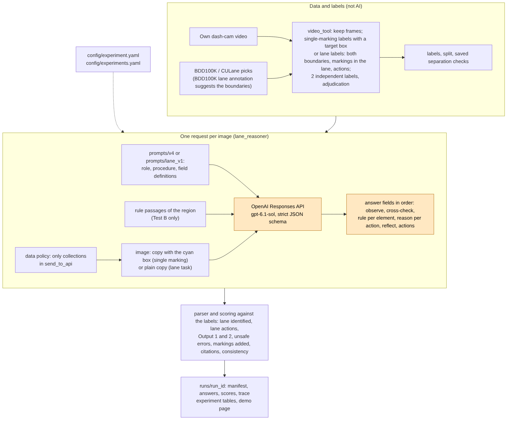

# Reasoning Driving

EGN 6216 AI Systems, Fall 2026. Jiahao Pang, University of Florida.

Research question: does the local traffic-rule text help a multimodal LLM read lane markings in different regions?

Lane markings mean different things in different countries, and a lane detector finds where the lines are but does not say what they allow. This project asks a multimodal model (OpenAI `gpt-6.1-sol`) what one marked lane marking in a dash-cam photo allows a car to do. Each image is asked twice: Test A with the image only, and Test B with the image plus the rule passages of the photo's region (MUTCD for the US, GB 5768.3-2025 for China). Everything else is the same, so the difference shows what the rule text adds. No region-specific model is trained, and the answers cite the rule they use, so they can be checked.

From Milestone 5 the unit is the lane the car drives in: both of its boundaries (colour, pattern, curb, role) and the guidance markings in it (arrows, prohibited-movement markings, words such as ONLY or 公交, waiting areas), with seven lane-level actions and a short advice, asked once per image (*Lane-level task*). A control, Test C, gives the passages of the other region instead, to see whether the answers follow the passages at all.

## Final submission (Milestones 5–6): run the Lane Rule Advisor

The deployed system is the lane-level advisor (`/app`): upload a dash-cam photo or a short clip, pick the region
(CN, US, UK, IN) and the rules setting (own region / none / another region), and it returns both lane lines, seven
lane-level actions with reasons, the cited rule IDs and a guard status ("needs review" when its checks fail).
Every answer is logged (`results/app/predictions.jsonl`) and counted for Prometheus; Grafana has the dashboard and
five alert rules. Details: [docs/lane_advisor.md](docs/lane_advisor.md), [docs/deployment.md](docs/deployment.md).

```bash
git clone https://github.com/Jonas-Pang/Reasoning-drive && cd Reasoning-drive
cp .env.example .env              # set GRAFANA_ADMIN_PASSWORD; NAVIGATOR_API_KEY is optional
docker compose up --build         # app http://localhost:8770/app · Grafana http://localhost:3000 · Prometheus http://localhost:9090
```

Without a project key, choose the model **Mock** (no model call) or paste your own OpenAI-compatible key in the
**Your API key** tab (kept in memory only). "Saved answer" mode replays the frozen test answers but needs the dataset
images (`DATASETS_ROOT`), which cannot be redistributed. Without Docker: `pip install -r requirements.txt` (Python 3.11),
then `python main.py web`. Self-test: `python main.py selftest`. The lane-level result tables are rebuilt from the
saved runs by `results/reports/final_m6/` (no model call). Milestone 4 (single-marking study, package `lane_reasoner`)
is commit `13d3ba5`. The sections below describe the whole project and were written during development.

## Project layout

The code is one package with a single entry point, and everything that changes between experiments lives outside the code: settings in `configs/`, prompt templates in `prompts/`, the countries' rules in `regulations/`, images and labels per country in `datasets/`, and every saved result in `results/`. The layout follows [DiLu](https://github.com/PJLab-ADG/DiLu) (one entry script, one settings folder, fixed prompt templates, an agent package and a results folder).

```
Reasoning_Drive/
├─ main.py                     the entry point: python main.py <command>
├─ configs/
│  ├─ api.yaml                 model and API: provider, model name, key variable, reasoning effort, prices
│  ├─ experiment.yaml          one experiment: region, Test A or B, prompt version, split, repeats, mock; lane task; data; image
│  ├─ experiments.yaml         the named experiments E1 to E6 and the runs that answer them
│  ├─ carla.yaml               CARLA server, the experiments A, B, C in simulation, the routes and their stops
│  ├─ lane_protocol.json       the frozen protocol of the test run (written by lane freeze)
│  └─ schemas/                 label_schema.json, lane_schema.json (the allowed values of every field)
├─ prompts/
│  ├─ v1/ … v4/                single-marking task (v4 selected)
│  ├─ lane_v1/, lane_v2/       lane-level task (lane_v2: the force of each passage, Test D)
│  └─ regulation_extraction/   reading a new standard's PDF into passages
├─ regulations/
│  ├─ US/  CN/                 region.yaml, passages_marking.json, passages_lane.yaml, norms.yaml, action_rules.json, lane_action_rules.json
│  ├─ UK/  JP/  IN/  SG/       region.yaml of the next countries (status planned until their passages are accepted)
│  ├─ _common/                 shared parts of the rule tables, Chinese labels of the values
│  ├─ _template/               blank files for a new country
│  └─ inbox/                   PDFs of new standards (not in Git)
├─ datasets/
│  ├─ US/  CN/                 dataset.yaml and one folder per label collection (own_video, bdd100k, culane)
│  ├─ UK/  JP/  IN/  SG/       dataset.yaml (the image sources of GeoDrive-Bench) and candidates_geodrive.csv
│  ├─ _template/               dataset.yaml and the label header for a new country
│  ├─ splits/                  split_v*.csv, separation checks, coverage, candidate supply
│  └─ sources.json, data_manifest.csv, data_hashes.csv
├─ results/
│  ├─ runs/<run_id>/           model runs: manifest.json, results.jsonl, scores.json, summary.md, trace.md
│  ├─ carla/<run>/             CARLA runs: frames/, decisions/, findings.json, the replay video (not in Git)
│  ├─ reports/                 evaluation reports (python main.py evaluate)
│  └─ index.csv                every saved run in one table (python main.py results)
├─ reasoning_drive/
│  ├─ agent/                   API client, prompt builder, runner of both tasks, reasoning trace
│  ├─ evaluation/              scoring, evaluation (precision, recall, F1, confusion matrices), experiments, review, protocol, results index
│  ├─ regulations/             regulation store and checks; extractor from a PDF
│  ├─ simulation/              CARLA: routes, loop, scenarios, suite, replay video
│  ├─ labeling/                labeling tool for videos and dataset images
│  ├─ web/                     web server, project page, metrics; static/ holds the pages
│  ├─ tests/                   self-tests
│  ├─ cli.py, config.py, paths.py
├─ notebooks/                  playground.ipynb (data), model_exploration.ipynb (Milestone 4), experiment.ipynb
├─ docs/                       data collection, labeling tool, model runs, deployment, permissions, pipeline diagram
├─ deploy/                     packages of the image, Prometheus and Grafana settings
├─ scripts/                    setup_windows.bat (the .venv environment), vscode/ (tasks and launch settings for VS Code)
└─ Dockerfile, docker-compose.yml, requirements.txt, .env.example
```

| DiLu | Here |
|---|---|
| `config.yaml` | `configs/api.yaml`, `configs/experiment.yaml`, `configs/carla.yaml` |
| `run_dilu.py` | `main.py` |
| `dilu/driver_agent/` (driver agent, prompts, memory) | `reasoning_drive/agent/` and `prompts/` |
| `dilu/scenario/` (highway-env) | `reasoning_drive/simulation/` (CARLA) |
| fixed system and human message templates, fixed answer format | fixed prompt templates in `prompts/` with slots: the rules step and the citation (Test A or B) and the rule block, filled from `regulations/<CODE>/`; a strict JSON answer (*Prompt paradigm*) |
| `results/` | `results/` with the run registry and the evaluation reports |

## Main entry

```bash
python main.py                      # the list of commands
python main.py web                  # the web page: http://localhost:8770 (demo), /project (the whole project), /review (blind review)
python main.py selftest             # every check, without the API and without CARLA
python main.py run --test AB --real # single-marking task;  python main.py lane run --test AB --real for the lane task
python main.py lane run --test B --prompt lane_v2 --real   # lane_v2: the force of each passage; --test D (no country), R (--from <Test A run>)
python main.py lane difficulty      # composition level (L1-L3) and rule sensitivity of every lane label
python main.py lane try frame1.png frame2.png --region UK --draft --mirror --prompt lane_v2 --real
                                    # photos without a label (a CARLA frame, a photo from a country without labeled images): Tests A and B
                                    # side by side, nothing scored; --draft allows a country whose passages are not accepted yet,
                                    # --mirror flips a right-hand-traffic frame for a left-hand-traffic country; results/trials/<time>_<CODE>/
python main.py results              # every saved run in one table (results/index.csv)
python main.py evaluate <run_id> [<run_id>]          # accuracy, precision, recall, F1, confusion matrices; two runs side by side
python main.py regulations list | check <CODE>       # the countries and their rule files
python main.py regulations extract --pdf regulations/inbox/<file>.pdf --code UK --name "the United Kingdom" --driving-side left --title "..." --real
python main.py regulations fetch [AU,AU-NSW,...]     # download each country's documents (region.yaml: documents) into regulations/inbox/<CODE>/
python main.py regulations extract-all [CODES] --real --budget 5   # extract every downloaded document not extracted yet (parents first)
python main.py regulations accept UK                 # the checked draft becomes the country's lane passages
python main.py regulations norms US [--write]        # the force of each passage (mandatory, recommended, permissive, informative)
python main.py label geodrive <CulturalDrive-Bench>/culturebenchmark_eval.json   # candidate frames with lane markings per country
python main.py carla routes | route route1 --record | video results/carla/<run> | map Town03_Opt
python main.py label ...            # the labeling tool
```

The project page (`/project`) runs the same things from the browser: the settings and the layout; the results table, where a click evaluates a run and a shift-click puts a second one beside it, with the confusion matrices; the countries, with the upload of a new standard's PDF, a cost estimate, the extraction as a background job, the draft with every quote checked against its page, and the accept button; and CARLA, with the server status, a start button, the routes, a run with a live log, and every run's stops, decision images and findings.

## VS Code

`scripts/vscode/` holds the VS Code settings of the project: copy its four files into a folder `.vscode/` in the project (VS Code reads them from there). Then:

* **Terminal > Run Task** lists every step: setting up `.venv` (`scripts/setup_windows.bat`, once), the self-test, the web page (it opens in the browser), the results table, evaluating one run or two side by side, lane runs (real or mock; the test, region and prompt are asked), the composition levels, the regulations (list, check, norms, extract mock or real, accept), CARLA (routes, drive a route, replay video) and Docker (build and start, self-test in the image, status, stop).
* **Run and Debug** has "Web page (opens /project)", which starts the page under the debugger and opens the project page when it is ready.
* The interpreter is `.venv` in the project folder (Python: Select Interpreter, if VS Code does not pick it by itself).

## Status

| Stage | Status | Where |
|---|---|---|
| Data collection | BDD100K validation split and CULane test split as candidate pools (only a small labeled sample is used), MUTCD Part 3, GB 5768.3-2025 | [`notebooks/playground.ipynb`](notebooks/playground.ipynb), [docs/data_collection.md](docs/data_collection.md) |
| Rule pack | 30 passages for single markings (16 US, 14 CN); 61 more for the lane task (30 US, 31 CN): edge lines, curbs, guide and lane-change lines, arrows, ONLY and other words, waiting areas, two-way left-turn, bus, HOV, tidal and reversible lanes, stop and yield lines, grids, entrance and exit lines | `regulations/US/`, `regulations/CN/` |
| Labels | single marking: 40 frames of one US night drive, two annotators; lane task: 68 CULane and 38 BDD100K development images, one annotator; test images not labeled yet | [labeling tool](docs/labeling_tool.md), `datasets/` |
| Splits | v1 and v2, with separation checks | `datasets/splits/split_v*.csv`, `datasets/splits/split_check_v*.json` |
| Model runs | 12 runs on development images (prompts v1 to v4, Test A and B; gpt-6-sol for comparison) | [`notebooks/model_exploration.ipynb`](notebooks/model_exploration.ipynb), `results/runs/` |
| Experiments | E1 rule text, E2 prompt version, E3 model setting, E4 repeats; lane task: E5 rule text, E6 controls (another region's passages, repeats) | `configs/experiments.yaml`, `python main.py experiment` |
| Lane-level task | prompt `lane_v1`, lane labels in the labeling tool (lane mode, offline packages), lane scoring, experiments E5 and E6; Test A and Test B run twice on the development images of both regions, the control Test C once | *Lane-level task*, `results/runs/*_lane*` |
| Blind review | page and scoring ready (`/review` on the demo page); decisions not made yet | *Blind review* |
| Test protocol | `lane freeze` records what may not change before the test run; not frozen yet | *Frozen protocol for the test run* |
| Web page | demo page: the lane task in a thinking window that prints the model's seven reasoning steps as it writes them, then its decision; uploaded photos; batch runs with a live log; the answers of finished runs; the single-marking task of Milestone 4. Project page: results, evaluation, regulations, CARLA | `python main.py web` (`/`, `/project`) |
| Regulations | one folder per country from a template; a new standard's PDF is read by the model into a draft of passages, with every quote checked against its page; the draft is used only after it is accepted | `regulations/`, `python main.py regulations` |
| Results and evaluation | 32 saved runs in one table; precision, recall, F1 and confusion matrices per run, with the unsafe errors | `results/`, `python main.py results`, `python main.py evaluate` |
| Force of the passages | every passage tagged mandatory, recommended, permissive or informative from the standard's own words (shall/should/may, 应/宜/可), reviewed in norms.yaml; lane_v2 prints it | `regulations/<CODE>/norms.yaml`, `prompts/lane_v2/` |
| Tests D and R | D: the country is not given (as in GeoDrive-Bench); R: only the passages about the elements of the model's own Test A answer | *Lane-level task* |
| Composition level, rule sensitivity | every lane label is L1, L2 or L3 (after DriveCombo) and rule-sensitive or not (another country's rules give another action, after GeoDrive-Bench); evaluate reports both | `python main.py lane difficulty` |
| Next countries | UK, Japan, India, Singapore: dataset settings with the image sources of GeoDrive-Bench and candidate frames; region settings with the official texts; drafts of passages from the extractor | `datasets/UK/` … `regulations/UK/` … |
| Simulation | CARLA 0.9.15: experiments A, B, C on continuous routes through every marking type of a map; the car states its intent and checks it against the answer before acting | `configs/carla.yaml`, `results/carla/`, `python main.py carla` |
| Deployment | Docker image; Docker Compose with Prometheus and Grafana | [docs/deployment.md](docs/deployment.md) |
| Test set | not run yet | |

## Results so far (development images, preliminary)

40 development images from one US night drive, each asked 3 times; the majority answer is scored. Output 2 counts only the actions the label decides, without contested rule-table cells (37 images). Cost counts cached input tokens at the cached price.

| Run | Configuration | Output 1 (marking) | Output 2 (actions) | Unsafe errors | Inconsistent answers | Same answer in all 3 repeats | Cost |
|---|---|---|---|---|---|---|---|
| 1 | Test A, prompt v1 (initial) | 40/40 | 36/37 | 1 | 6 | 82.5% | $0.35 |
| 2 | Test B, prompt v1 (targeted change: rule passages added) | 39/40 | 35/37 | 0 | 7 | 80.0% | $0.31 |
| 3 | Test A, prompt v2 | 39/40 | 35/37 | 1 | 0 | 90.0% | $0.38 |
| 4 | Test B, prompt v2 | 40/40 | 36/37 | 0 | 0 | 97.5% | $0.41 |
| 5 | Test A, prompt v3 (reasoning before the decision) | 40/40 | 34/37 | 3 | 0 | 92.5% | $0.49 |
| 6 | Test B, prompt v3 | 39/40 | 34/37 | 2 | 0 | 95.0% | $0.51 |
| 7 | Test A, prompt v4 (the rule for the specific marking decides) | 40/40 | 33/37 | 4 | 0 | 95.0% | $0.50 |
| 8 | Test B, prompt v4 (selected) | 39/40 | 36/37 | 0 | 0 | 100% | $0.52 |
| 9 | Test A, v4, gpt-6-sol, effort low | 35/40 | 31/37 | 2 | 0 | 85.0% | $0.55 |
| 10 | Test B, v4, gpt-6-sol, effort low | 37/40 | 34/37 | 0 | 1 | 82.5% | $0.60 |
| 11 | Test A, v4, gpt-6-sol, effort none, temperature 0 (Milestone 3 plan) | 34/40 | 30/37 | 3 | 0 | 82.5% | $0.43 |
| 12 | Test B, v4, gpt-6-sol, effort none, temperature 0 | 33/40 | 30/37 | 0 | 1 | 95.0% | $0.48 |

The run IDs of every row are in `configs/experiments.yaml`. Mean latency with gpt-6.1-sol 4.1 to 5.5 s per request (p95 7.3 to 10.0 s); with gpt-6-sol 2.8 to 4.5 s.

* The rule text removed the unsafe error (a single solid yellow left-edge line: Test A allows crossing, Test B cites MUTCD 3B.09 ¶03 and prohibits it). Accuracy did not change: exact McNemar p = 1.0 for every pair of runs.
* Prompt v2 removed the self-contradicting answers and made the three repeats agree more often, at the same accuracy.
* Prompt v3 makes the reasoning visible but did not improve accuracy (v2 to v3: Output 2 from 35 to 34 in Test A, from 36 to 34 in Test B; exact McNemar p = 1.0 and 0.5). The traces show why: on yellow left-edge lines the model combines the task convention "an action that is only discouraged counts as allowed" with the general passage 3A.04-01 ("a solid line discourages or prohibits crossing") instead of the specific passage 3B.09-03, and answers that crossing is allowed. Each request costs about 15 to 20% more.
* Prompt v4 (the rule written for the specific marking decides; a restriction counts as prohibited) fixed both v3 failures in Test B: 36/37, no unsafe error, the same answer in all 3 repeats. In Test A it made the wrong belief consistent: all 12 requests on the yellow left edge lines answered that crossing is allowed (4 unsafe errors). With v4 the rule text makes the largest difference (0 vs 3 discordant images, exact McNemar p = 0.25). v4 was tuned on these images, so this is an upper bound.
* The Milestone 3 setting (gpt-6-sol, effort none, temperature 0) recognized 6 fewer markings than gpt-6.1-sol (exact McNemar p = 0.03 in both tests), and temperature 0 did not make the repeats agree more often. It is faster and about 10% cheaper. gpt-6.1-sol with effort low stays.
* The majority of 3 repeats changes Output 2 on at most 2 images per run compared with a single request (none with v4).
* Selected: gpt-6.1-sol, effort low, Test B, the prompt design of v4. The ego lane is now the task unit (*Lane-level task*), asked once per frame.
* Open cases: the faint edge line `f0008220` (possible label error) and the contested U-turn from a left-turn lane.
* The images are easy, come from one drive and from the region the model knows best, so A and B can hardly differ yet.

Details, error cases and the reasons for each change are in [`notebooks/model_exploration.ipynb`](notebooks/model_exploration.ipynb).

## Reproduce

Tested on macOS (Apple silicon) with Python 3.11, on Windows 11 with Python 3.11 (and the CARLA client with Python 3.8), and on Linux with Python 3.10 and 3.13. On Windows, `scripts\setup_windows.bat` creates `.venv` with Python 3.11 and the packages and runs the self-test.

### 1. Install and run the self-tests

```bash
git clone https://github.com/Jonas-Pang/Reasoning-drive.git && cd Reasoning-drive
conda create -n reasoning-driving -c conda-forge --override-channels python=3.11 -y
conda activate reasoning-driving
pip install -r requirements.txt

python main.py selftest    # settings, prompts, scoring, runs, trace, web pages, experiments, lane task, review, protocol, Docker files,
                           # labeling tool, regulation template and extractor, evaluation, results index, CARLA settings
```

Recompute the results from the saved runs (no API calls):

```bash
python main.py experiment                 # list the named experiments (configs/experiments.yaml)
python main.py experiment E1_rules        # table, paired comparisons and McNemar tests of one experiment
python main.py compare 20261027_021643_testA_US 20261027_021740_testB_US
```

### 2. Set your OpenAI API key

```bash
cp .env.example .env
```

Open `.env` and set `OPENAI_API_KEY=` to your own key (Section 1 of `notebooks/experiment.ipynb` can also write it for you). `.env` is listed in `.gitignore`. Then check the key and the model:

```bash
python main.py ping --real
```

### 3. Get the data

Run all cells of `notebooks/playground.ipynb`. It downloads BDD100K and MUTCD, checks the five CULane archives (download them in the browser from the official page; the notebook names the files) and unpacks everything. Then compare your files with `datasets/data_hashes.csv`:

```bash
python main.py label hash-sources
```

Set `DATA_DIR` in `.env` if the data is not in `data/`.

### 4. Label images

One workspace folder per collection under one root folder; set `DATASETS_ROOT=<root>` in `.env`.

```bash
python main.py label --data "<root>/bdd100k" images init bdd100k
python main.py label --data "<root>/culane"  images init culane
python main.py label --data "<root>/bdd100k" label
python main.py label combine "<root>/UF" "<root>/bdd100k" "<root>/culane"
```

`combine` writes the labels, the split and the separation check to `datasets/`. Own dash-cam videos go through `label ingest`, `scan` and `label`. The procedure is described in [docs/labeling_tool.md](docs/labeling_tool.md).

`label` works at lane level (Milestone 5): ① picks dataset images with my lane suggested from the dataset's own lane labels (or keeps frames of an own video), ② labels my lane per image, ③ decides disagreements, ④ makes lane packages for helpers and imports their results. The same steps without the app:

```bash
python main.py label --data "<root>/culane" lanes                       # only the lane page
python main.py label --data "<root>/culane" lanes-package --to ann01     # offline package for a helper
python main.py label --data "<root>/culane" lanes-import results_*.json  # the helper's results
python main.py label --data "<root>/culane" lanes-status                 # counts and agreement
```

### 5. Run the model

```bash
python main.py ask <image_id> --real                          # one image, reasoning printed step by step
python main.py run --test AB --split dev --repeats 3 --real   # add --trace to print every answer's reasoning
python main.py trace <run_id>                                 # reasoning of a saved run
python main.py demo
python main.py lane run --test AB --split dev --real          # lane-level task, one request per image
python main.py lane run --test C --split dev --real           # control: the other region's passages
python main.py experiment E5_lane_rules --real                # Test A against Test B at lane level
python main.py experiment E6_lane_controls                    # Test C and the repeats, from the saved runs
```

or run all cells of `notebooks/model_exploration.ipynb`. All settings are in `configs/experiment.yaml` (see *Configuration*).

### 6. Docker

The same environment in a container, with the demo page and monitoring (Prometheus and Grafana):

```bash
# in .env: GRAFANA_ADMIN_PASSWORD (required), OPENAI_API_KEY, DATASETS_ROOT
docker compose up --build     # demo page http://localhost:8770, Grafana http://localhost:3000, Prometheus http://localhost:9090
docker compose run --rm demo python main.py selftest
docker compose run --rm demo python main.py lane run --test AB --split dev --real
```

Details, metrics and the safety settings: [docs/deployment.md](docs/deployment.md).

## Configuration

The settings are in three files in `configs/`, each with a comment for every setting:

| File | What it sets |
|---|---|
| `configs/api.yaml` | `model`: provider, API address, name of the key variable (the key itself is in `.env`), model name, reasoning effort and summary, temperature, image detail, output limit, retries, parallel requests, prices per model |
| `configs/experiment.yaml` | `experiment`: region, `use_rules` (no = Test A, yes = Test B), prompt version, split, repeats, mock; `lane`: prompt and output limit of the lane task; `data`: workspaces whose final labels are used and the collections that may be sent to the API; `image`: the target box |
| `configs/carla.yaml` | `server`: host, port, CARLA folder and version, the Python with the `carla` package, start options; `experiments`: A, B, C as region and test; `routes`: map, weather, seed and the stops of each route |

```yaml
# configs/experiment.yaml
experiment:
  region: US          # a folder under regulations/ (US, CN, ...)
  use_rules: no       # no = Test A (image only); yes = Test B (image + rules)
  prompt: v4          # folder under prompts/
  split: dev
  repeats: 1
  mock: true          # true = no API calls
lane:
  prompt: lane_v1
  max_output_tokens: 6000
```

The countries are not listed in the settings: every folder `regulations/<CODE>/` with a `region.yaml` is a country (*A new country*). The command line options (`--test`, `--region`, `--split`, `--repeats`, `--real`) override the settings for one run.

The web page reads the files when it starts. Its controls (Test A/B, region, mock or real) and the settings dialog (model, prompt version, reasoning effort and summary, image detail, output limit, parallel requests) change the settings of the open page only. The dialog lists the settings that differ from the files; ticking "save as default" writes them into `configs/api.yaml` (model settings) or `configs/experiment.yaml` (the rest), changing only those values and keeping the comments. "Reload from file" reads the files again.

### API

The model and request settings are in `configs/api.yaml`. The key is read from the environment variable named in `api_key_env` (default `OPENAI_API_KEY`), set in `.env`.

### Prompt paradigm

Every request is built from the same fixed templates; only the photo and the rule block change. The instructions are `role.txt`, `procedure.txt` and `fields.txt` of the prompt folder, with two slots filled per test: the rules step (`step2_A`/`step2_B`, or `rules_step_A`/`rules_step_B` in the lane task) and the citation (`citation_A`/`citation_B`). In Test B the rule block follows: `rules_header.txt` with the country's name and standard, then the country's passages from `regulations/<CODE>/`, grouped by the part of the lane they are about, each as `[rule_id] source, section, page` and its text. The user message is `user.txt` with the country's name and driving side, and the photo. The answer must match a strict JSON schema built from `configs/schemas/`. So a new country changes only what is filled into the slots, never the templates, and the prompt hashes of every run are kept in its manifest. Details: [prompts/README.md](prompts/README.md).

### Prompts

Each prompt version is a folder under `prompts/`. Version v3 is split by purpose:

| File | Content |
|---|---|
| `role.txt` | who the model is and which marking it judges |
| `procedure.txt` | how it processes the photo: look, rule, decide, check |
| `step2_A.txt`, `step2_B.txt` | step 2 without rules (Test A) and with the rule passages (Test B) |
| `fields.txt` | how to fill in each answer field; definitions of marking types and actions |
| `citation_A.txt`, `citation_B.txt` | how to fill in `cited_rule_id` |
| `rules_header.txt` | heading of the rule block (Test B) |
| `user.txt` | the input message sent with the photo |
| `answer_fields.txt` | order of the answer fields |

`python main.py prompt --test B` prints the full prompt as it is sent.

### Reasoning before the decision

In v3 the model writes its answer in this order: what it sees (`description`, `evidence`, `marking`), which rule applies (`rule_reasoning`, `cited_rule_id`), one reason per action (`action_reasons`), a check (`self_check`), and only then the decision (`actions`). The decision therefore follows from the steps before it. `ask`, `run --trace`, `trace` and `results/runs/<run_id>/trace.md` print these steps for every answer, with the label and the cost. With `reasoning_summary: auto` the trace also shows the model's own summary of its hidden reasoning (the API returns a summary, not the hidden tokens).

### A new country

Every country is a folder `regulations/<CODE>/`, made from `regulations/_template/`:

| File | Content |
|---|---|
| `region.yaml` | code, name as it goes into the prompt, driving side, the standard (title, language, PDF, licence), which passage files and rule tables the tasks use |
| `passages_marking.json`, `passages_lane.yaml` | the passages: `rule_id`, `region`, `source`, `section`, `page`, `element` or `marking_type`, `text_en` and the original text |
| `action_rules.json`, `lane_action_rules.json` | rule tables that prefill consistent labels; never used to score the model |

The passages of a new standard can be read from its PDF by the model:

```bash
python main.py regulations extract --pdf regulations/inbox/<file>.pdf --code UK --name "the United Kingdom" --driving-side left --title "Traffic Signs Manual, Chapter 5" --real
python main.py regulations check UK      # fields, files, duplicate IDs, rule IDs of the tables
python main.py regulations accept UK     # after reading the draft: it becomes passages_lane.yaml
```

The extractor keeps only the pages that mention lane markings (in English, Chinese, German, French, Spanish, Japanese and other languages), sends them in groups of up to six pages with the prompt in `prompts/regulation_extraction/` (fixed sections, a strict answer schema), and writes `passages_draft.yaml` and `extraction_log.json` (pages, groups, tokens, cost). Every quote is compared with the text of its page; a quote that is not found is marked `verified_quote: false` and must be checked by a person. `--mock` runs the whole path without the API, and the project page shows the estimated cost before the extraction starts. A scanned PDF without a text layer needs OCR first. The draft is not used by any run until it is accepted. Every passage also gets its force (`norm`: mandatory, recommended, permissive or informative), and the draft says where the model's value disagrees with the standard's own words (`norm_check`). The extractor writes no rule tables: copy them from `regulations/_template/` and fill them in, using the actions each passage states (`actions_stated` in the draft), so the labeling tool can prefill labels. Marking types outside the schema, such as UK zig-zag lines, need values in `configs/schemas/lane_schema.json`.

### Countries with several documents, states and territories

A country can list several documents in `region.yaml` under `documents:` (official URL, a fallback URL or an index page on
which the current version is linked, where the file is kept, and optionally narrower `keywords` for a long law).
`python main.py regulations fetch` downloads what is missing, checks that a PDF is a PDF and an HTML page is not an error
page, and records URL, size and checksum in `regulations/inbox/sources_log.json`. `python main.py regulations extract-all
--real --budget 5` extracts each document once (a second run skips documents already extracted from the same file); each
document gets its own draft in `regulations/<CODE>/drafts/<tag>.yaml` with rule IDs like `UK-TSRGD-...`, and the drafts are
merged into `passages_draft.yaml`.

A state or territory whose road rules copy a national model law names it with `parent:` (Australia: the Australian Road
Rules are the model, `AU`; New South Wales, Victoria, Queensland, South Australia, Tasmania, the ACT and the Northern
Territory are `AU-NSW` ... `AU-NT` with `parent: AU`). Its document is compared line by line with the parent's
(`same_as: AU:arr`): pages copied word for word are not sent to the model, only what the state changed or added. In the
prompt the state gets the parent's passages and its own; a passage of its own replaces the parent's passages of the same
rule number. Western Australia has its own Road Traffic Code with different numbering and is read on its own. In the
United Kingdom, The Highway Code (Great Britain version) and the Traffic Signs Regulations and General Directions 2016
apply to England, Scotland and Wales alike, so `UK` covers all three (`applies_to`); Northern Ireland has its own Highway
Code and is `UK-NI`.

| Region | Documents |
|---|---|
| UK (England, Scotland, Wales) | The Highway Code rules 103-158 and Road markings (gov.uk); TSRGD 2016 Schedule 9 (legislation.gov.uk) |
| UK-NI | The Highway Code for Northern Ireland, rules 103-158 (nidirect) |
| AU | Australian Road Rules, model law of 9 June 2023 (pcc.gov.au) |
| AU-NSW, AU-VIC, AU-QLD, AU-SA, AU-TAS, AU-ACT, AU-NT | the state's or territory's road rules from its legislation register (parent AU) |
| AU-WA | Road Traffic Code 2000 (legislation.wa.gov.au) |
| SG | Road Traffic (Traffic Signs) Rules, Highway Code, Road Traffic Rules (Singapore Statutes Online) |

### Force of the passages

Standards say how binding a sentence is with fixed words: MUTCD "shall" (Standard), "should" (Guidance), "may" (Option); GB 5768 应, 不得, 禁止 / 宜 / 可; the UK Highway Code MUST / should; Japanese laws しなければならない / してはならない. `python main.py regulations norms <CODE> --write` proposes the force of every passage from these words (`reasoning_drive/regulations/norms.py`; a country can give its own words as `norm_words` in `region.yaml`) and writes them to `regulations/<CODE>/norms.yaml`, where a person reads them and sets `checked: true` or corrects them. The passage files do not change. Prompt `lane_v2` prints the force next to every passage and says how to use it: a mandatory passage or a definition decides a prohibition; a recommended or informative passage that only discourages an action does not prohibit it. This targets the error of prompt v3, where the general passage "a solid line discourages or prohibits crossing" was read against the specific rule for edge lines. For a new country the extractor proposes the force in the same way, so nothing has to be written by hand except the review.

### New images

Every country also has a folder `datasets/<CODE>/` (from `datasets/_template/`) with `dataset.yaml`: its label collections, their sources and licences, and the split rule shared by all countries (a clip goes to development if `sha1("6216:" + clip) mod 10 = 0`; 6 development and 30 test images per marking type, plus 30 degraded test images). Each collection folder holds the final labels of one labeling workspace, made with `python main.py label`: `label ingest` for own dash-cam videos, `label images init bdd100k|culane` for the two datasets. A workspace listed under `data.workspaces` is read for its final labels, and its images are sent to the API only if its collection is in `data.send_to_api`. Another public dataset needs a reader in `reasoning_drive/labeling/imagesets.py`. The development and test images of a new country are chosen and split the same way as for the US and China, and `datasets/splits/` holds the combined split.

### The next countries

The image sources are those GeoDrive-Bench uses, one per country; each must be downloaded from its own page after accepting its terms, and is then read as a folder of images (`reader: folder` in `dataset.yaml`; one clip per folder, so development and test images never share a drive):

| Country | Images | Rule text | Candidates |
|---|---|---|---|
| UK | LingoQA (Wayve), London | The Highway Code, rules 103-158 (gov.uk, Open Government Licence) | 488 frames |
| Japan | CoVLA (Turing), academic use by licence agreement | 道路標識、区画線及び道路標示に関する命令 (e-Gov; laws are not protected by copyright) | 418 frames |
| India | IDD Multimodal (IIIT Hyderabad), registration | The Motor Vehicles (Driving) Regulations, 2017 | 561 frames |
| Singapore | nuScenes (Motional), CC BY-NC-SA 4.0 | Road Traffic (Traffic Signs) Rules, Highway Code, Road Traffic Rules (Singapore Statutes Online) | 797 frames |
| China, next to CULane | ONCE (Huawei), CC BY-NC-SA 4.0 | GB 5768.3-2025 (as now) | 333 frames |

The candidates are the frames of GeoDrive-Bench's questions that mention lane markings (`python main.py label geodrive`); only their paths are kept. `python main.py label --data <root>/lingoqa images init lingoqa --source <the unpacked dataset>` marks them as `listed` when picking images.

## Results and evaluation

Every run is saved with its settings, prompt hashes, answers and scores (`results/runs/<run_id>/`, `results/carla/<run>/`), so the numbers can be recomputed without new requests.

```bash
python main.py results                     # every run in one table, also written to results/index.csv
python main.py results --kind lane         # marking, lane, carla_route, carla_suite, carla_loop, carla_scenarios
python main.py evaluate 20261105_074605_laneB_CN
python main.py evaluate 20261105_074605_laneA_CN 20261105_074605_laneB_CN
```

`evaluate` also reports the lane actions per composition level and on the rule-sensitive images (`python main.py lane difficulty`: L1 one kind of governing element, L2 several kinds deciding their own actions, L3 elements that interact, such as a solid-and-broken pair, a special lane, or a marking that closes a movement while a boundary closes the way out of the lane; rule-sensitive: another country's rule table gives another value to an action the label decides). For Test D it counts the country the answer names, for Test R the passages per prompt.

`evaluate` writes `results/reports/<run_id>.md` and `.json`: for the actions, every (image, action) cell the label decides, without contested cells, with "prohibited" as the positive class: accuracy, precision, recall and F1, the same for "allowed", macro-F1, the confusion matrix (allowed, prohibited, not_determined, not_applicable), recall of "prohibited" per action, unsafe errors (label prohibits, answer allows) and over-cautious answers (label allows, answer prohibits or does not decide). Marking runs add the per-class scores and the confusion matrix of the marking type; lane runs add them for the colour and pattern of both boundaries, and precision, recall and F1 of the markings in the lane. The counts of unsafe errors agree with the runs' own scores.

## Simulation in CARLA

CARLA 0.9.15 runs as its own server (on Windows, `CarlaUE4.exe`; it needs a GPU and is not in the Docker image). The client runs with a Python that has the `carla` package of the same version (`server.python` in `configs/carla.yaml`, Python 3.8 for the Windows package); `python main.py carla route` started from the project's Python switches to it by itself.

```bash
python main.py carla routes                      # the routes of configs/carla.yaml and their stops
python main.py carla map Town03_Opt              # the map CARLA opens at start (restart CARLA after it)
python main.py carla route route1 --record       # drive route1; --mock for made-up answers, --preview to check the stops
python main.py carla video results/carla/<run>   # the replay video with the answers (needs ffmpeg)
python main.py carla countries                   # the same places on Town03 asked and driven as the US, China, the UK and Japan
python main.py carla countries-video results/carla/<run>   # its video: the full prompts, each answer's reasoning, the drive
python main.py carla opendrive-test              # a generated OpenDRIVE road as right- and left-hand traffic (CARLA 0.9.16)
```

`carla countries` (settings under `countries` in `configs/carla.yaml`) drives to each scene, stops, and asks the lane task (lane_v2)
Test A and Test B for each country; the car does the navigation intent only if the Test B answer allows it. The CARLA towns
are right-hand traffic, so for the UK and Japan the photo is flipped left to right before it is sent (a mirror world), the
answer's left and right are flipped back to drive, and the video shows that country flipped. CARLA 0.9.16 reads
`rule="LHT"` on OpenDRIVE roads (`carla opendrive-test` shows the lanes change direction), but a road generated in
standalone mode has no painted markings, so it cannot be used for the lane task yet.

A route is one continuous loop through every kind of lane marking of a map. At each stop the car states its navigation intent, the photo is asked once per experiment (A: US rules not given, B: US rules, C: Chinese rules on a US road), and the car checks the intent against the answer of the experiment it drives with before it acts. The run folder holds the frames, one decision image per stop, `findings.json` and the replay video. The project page starts CARLA, runs a route with a live log and shows every run.

## How the system works



| Part | AI? | What it does | How it is tested |
|---|---|---|---|
| Frame keeping, target box, labels | no | people label marking type, visibility, six actions and accepted rule IDs; a rule table fills in consistent defaults | agreement (Fleiss κ), adjudication, label checker |
| Prompt builder | no | fixed templates plus the region's passages (Test B) | self-test: Test A has no passage, Test B has exactly the region's passages |
| Image preparation | no | draws the cyan box on a copy and encodes it as JPEG | self-test |
| Model | yes | interprets the marking: type, arrow directions, position, evidence level, six actions, cited passage | model runs |
| Parser and schema | no | strict JSON schema; unreadable answers are counted, not repaired | self-test |
| Scoring | no | compares with the labels; contested cells kept separate; McNemar test | self-test |
| Policy, retries, cache | no | sends only permitted collections; retries on 429 and 5xx; caches identical requests | self-test with a fake API server |

The answer fields of prompt v3, in the order the model writes them, are `description`, `evidence` (full, partial or insufficient), `marking` (Output 1: type, arrow type, position), `rule_reasoning`, `cited_rule_id` (Test B), `action_reasons`, `self_check` and `actions` (Output 2: cross line, go straight, turn left, turn right, U-turn, enter centre lane; each allowed, prohibited, not_determined or not_applicable). In v1 and v2 the fields are `description`, `evidence`, `marking`, `actions`, `cited_rule_id` and `reasoning`.

### Prompt versions

| Version | What it is | Runs | Result |
|---|---|---|---|
| v1 | The first prompt: one instructions file with three steps (describe, match a rule, decide); the reasoning is written after the actions | 1, 2 | 6 to 7 answers per run contradict themselves; repeats agree on 80 to 82% of images |
| v2 | v1 corrected after its errors on development images: describe only visible features, which actions each marking type governs, `not_determined` only with partial evidence, a self-check step, and in Test B "use the passages, not memory" | 3, 4 | no contradictions; repeats agree on 90 to 97.5%; same accuracy |
| v3 | v2 split into files by purpose; each reasoning step is an answer field written before the actions | 5, 6 | reasoning visible in every answer; one or two more errors (see *Results so far*) |
| v4 | v3 with two changes: the rule for the specific kind of marking decides, and a restriction counts as prohibited | 7 to 12 | Test B: 36/37, no unsafe error, all repeats agree; Test A: 4 unsafe errors (selected for the test run) |

Each folder has a README with the details ([v1](prompts/v1/README.md), [v2](prompts/v2/README.md), [v3](prompts/v3/README.md), [v4](prompts/v4/README.md)).

### Measures against unsupported answers

* The model describes what it sees before it decides (v3: as separate fields before the actions).
* The answer must match a strict schema with fixed values, so it cannot invent categories.
* The evidence level lets the model say that the photo does not show enough, instead of guessing.
* Test B may cite only the listed passage IDs; the scoring checks each citation.
* Repeated requests show how stable the answers are, and the majority answer is scored.
* A consistency check that needs no labels (`scoring.consistency_issues`) counts answers that contradict themselves.
* Lane task (`prompts/lane_v1`): an observation sentence before the attributes of every boundary and marking, an evidence level for each, a cross-check of the observations before any rule, one rule per element, a reason per action, a reflection, and the actions last; the program checks the answer for contradictions without the label (`lane_scoring.consistency_issues`) and counts markings that are not in the label, with the evidence level the model gave them.

### Metrics

* Output 2 exact match (main metric), unsafe errors (label prohibits, model allows), and precision, recall and F1 of "prohibited" over all (image, action) pairs.
* Output 1 accuracy, per-class precision, recall and F1, macro-F1, confusion matrix.
* Evidence groups, citations, confidently wrong answers, inconsistent answers.
* Repeatability, readable answers, latency, tokens and cost.
* Exact McNemar test on paired images.

## Lane-level task

A lane is formed by two boundaries and may carry guidance markings, so the boundaries and the markings are read together. Prompt `lane_v2` adds the force of each passage; its Test A is the same request as with `lane_v1`. Two more tests: **Test D** is Test A without the country in the user message (the model infers it, as in GeoDrive-Bench, and names it); **Test R** is Test B with only the passages about the boundaries and markings that the model itself reported in a saved Test A answer of the same image (`--from <run>`), a shorter rule block chosen without the label. Experiments `E7_lane_norms`, `E8_lane_country_given` and `E9_lane_retrieval` compare them. One request per image; the model sees the photo without any box.

What is labeled per image (`datasets/<CODE>/<collection>/<set>.lanes.csv`, values in `configs/schemas/lane_schema.json`):

* the number of lanes of my direction and the position of my lane (1 = leftmost), with an evidence level;
* each boundary: colour (white, yellow, other, none), pattern (solid, dashed, dotted, double solid, double dashed, solid and dashed, none), which line of a solid-and-dashed pair is nearer my lane, curb (yes or no), role (lane line, centre line, edge line, special lane line), evidence; the line itself can be drawn on the image for checking and is never sent to the model;
* the markings in my lane as tokens, for example `arrow:left;text:only;line:stop_line`, with an evidence level;
* seven actions (change left, change right, go straight, turn left, turn right, U-turn, enter a waiting area or a two-way left-turn lane), each allowed, prohibited, not_determined or not_applicable, and the accepted rule IDs.

Test images are to be labeled by two annotators independently (local page or offline package); agreeing labels become final, disagreements are decided by the owner, and agreement per field is written to `lane_agreement.csv`. The development images so far have one annotator, the author, who also wrote the prompt; their errors are checked by the blind review below. `regulations/<CODE>/lane_action_rules.json` suggests the actions and rule IDs from the observed attributes; it is never used to score the model. For BDD100K images the page suggests both boundaries from the dataset's own lane annotation (colour, pattern, curb); for CULane it suggests their position.

The prompt `prompts/lane_v1` checks itself inside one response: observe the scene, each boundary and each marking (an observation sentence before the attributes), cross-check the observations against each other (lane position against boundary roles, colour against role, arrows against words and areas, anything reported without being seen), apply one rule per element (Test B: a passage ID; the rule for the specific kind of marking decides), give a reason per action, reflect on the decision, then write the actions and the advice. Test A and Test B differ only in the rules step, the citation slot and the rule block. Test C, the control, is Test B with the rule block of the other region under its real title (US images with the GB 5768 passages, Chinese images with the MUTCD passages): B and C differ only in the content of the passages.

Scores per run (`reasoning_drive/evaluation/lane_scoring.py`): lane identified (both boundaries and the marking set correct), lane actions (every action the label decides), per boundary attribute, markings added that are not in the label and markings missed, lane count and position, unsafe errors (label prohibits, answer allows), prohibited actions kept, contested cells separately, citations, and contradictions inside the answer found without the label. Lane identification and the marking set are also scored without the lines across the lane (stop and yield lines, crosswalks), the part of "my lane" whose extent is least clear. An image without a readable answer counts as wrong. Two runs are compared on the same images with the exact McNemar test and the difference in accuracy with Newcombe's 95% interval; when a test was run more than once, the share of correct answers per image is compared (exact sign test, approximate 95% interval from a bootstrap over images). Experiments `E5_lane_rules` and `E6_lane_controls`.

A smoke test on four unlabeled frames (two own US night frames, two CULane frames; not scored) checked that the API accepts the answer schema: about 1,000 to 1,700 output tokens and 17 to 40 s per answer, about $0.019 per request on average with the prompt cache. Labeling 40 development images per region and running both tests would cost about $3.

### Lane-level results (development images, preliminary)

`gpt-6.1-sol`, reasoning effort low, prompt `lane_v1`, one request per image per run; one annotator per development image; scored before the blind review. Test A and Test B were run twice with new requests, Test C once.

| First run | China A | China B | China C | US A | US B | US C |
|---|---|---|---|---|---|---|
| Lane identified (both boundaries and the markings) | 34/68 (50%) | 33/68 (49%) | 33/68 (49%) | 17/38 (45%) | 17/38 (45%) | 21/38 (55%) |
| Lane identified, lines across the lane not counted | 38/68 (56%) | 37/68 (54%) | 37/68 (54%) | 21/38 (55%) | 21/38 (55%) | 24/38 (63%) |
| Lane actions | 57/68 (84%) | 58/68 (85%) | 31/68 (46%) | 27/36 (75%) | 28/36 (78%) | 29/36 (81%) |
| Both boundaries | 42/68 (62%) | 41/68 (60%) | 42/68 (62%) | 27/38 (71%) | 25/38 (66%) | 28/38 (74%) |
| Markings, exact set | 53/67 (79%) | 53/67 (79%) | 53/67 (79%) | 27/37 (73%) | 28/37 (76%) | 29/37 (78%) |
| Unsafe errors | 2 | 2 | 40 | 5 | 3 | 2 |
| Cost (USD) | 0.86 | 0.94 | 0.98 | 0.48 | 0.53 | 0.52 |

| Second run | China A | China B | US A | US B |
|---|---|---|---|---|
| Lane identified | 37/68 (54%) | 32/68 (47%) | 19/38 (50%) | 15/38 (39%) |
| Lane actions | 57/68 (84%) | 58/68 (85%) | 27/36 (75%) | 30/36 (83%) |
| Both boundaries | 45/68 (66%) | 40/68 (59%) | 28/38 (74%) | 23/38 (61%) |
| Unsafe errors | 2 | 2 | 5 | 3 |

What the runs show:

* **The answers follow the passages.** With the US passages, the lane actions on Chinese images fell from 85% (Test B) to 46% (Test C), and the unsafe errors rose from 2 to 40 (exact sign test p < 0.001). All 40 are lane changes allowed across a white solid line: the model applied the MUTCD passages it was given (a solid white lane line marks where crossing is discouraged, cited 25 times; an edge line delineates the roadway edge, read as not prohibiting crossing, 12 times), while GB 5768 prohibits crossing these lines. On US images the Chinese passages did not lower the scored actions; they turned the 8 crossings of white solid lines that the US labels allow (contested cells, scored apart) into prohibitions.
* **The region's own passages did not improve the decisions on these images.** Over both runs and both regions (106 images, 212 answers per test), lane actions were 80.8% with Test A and 83.7% with Test B: +2.9 points (approximate 95% interval −2.4 to +8.6; sign test p = 0.80); unsafe errors 7 and 5 per run. A gain of more than about 9 points is unlikely on these images; a smaller one cannot be ruled out. Since the model follows the passages (previous point), its own knowledge already agrees with them on these images.
* **The passages cost a little in reading the lines.** Both boundaries correct: 67.0% with Test A, 60.8% with Test B, −6.1 points (−10.4 to −2.4; Test A right more often on 11 images, Test B on 1; sign test p = 0.006); lane identified −4.7 points (p = 0.04). Test B more often reports only the curb where a white solid line runs next to it (China), or calls a broken line dotted (US).
* **Two runs of the same test differ by a few images.** Test A against its repeat: lane identified 6 against 1 discordant images, lane actions 3 against 3; Test B against its repeat: 2 against 5 and 6 against 4. A single comparison of A and B with 3 to 7 discordant images per measure is within this variation; the combined comparison above uses both runs.
* **Markings.** 14 of the 19 markings added in China and 10 of 16 in the US are lines across the lane (stop lines, crosswalks), most with partial evidence; no Chinese label lists one. Without them, lane identification rises by 4 images in each region. The blind review decides whether these are label omissions or hallucinations.
* No cited ID is outside the given list once 6 IDs written in brackets (`[CN-5.2.3]`) are read without them; no answer contradicts itself under the program's checks, which now also cover broken lane lines, solid-and-broken pairs and sides that cannot be seen.

Runs: `results/runs/20261103_034158_lane{A,B}_CN`, `results/runs/20261103_095848_lane{A,B}_US` (first run), `results/runs/20261105_074605_lane{A,B}_CN`, `results/runs/20261105_075052_lane{A,B}_US` (second run), `results/runs/20261105_074059_laneC_{CN,US}` (control). `python main.py experiment E6_lane_controls` rebuilds the table; `python main.py lane compare` with the four A and B runs of both regions gives the combined comparison.

### Blind review

`python main.py demo`, then http://localhost:8770/review: every field where a saved answer of Test A or Test B differs from the label: now 169 items on 74 images (100 in China, 69 in the US) from the four runs of each region. Test C is left out, since its actions follow the other region's rules. Each item shows the photo without the drawn label lines and the values of the label and of the answers as options, in a fixed shuffled order and without their source; "cannot tell from the photo" is always possible. The decisions go to `results/runs/review/lane_review.csv`; the label files are not changed. `python main.py lane rescore <run_id>... --reviewed` writes the scores after the review next to the originals (`scores_reviewed.json`), `lane compare ... --reviewed` compares them, and the page shows before and after for every run. The reviewer should not be the annotator of the image where possible; the author reviewing his own development labels is recorded as such (reviewer field).

### Frozen protocol for the test run

`python main.py lane freeze --note "..."` records in `configs/lane_protocol.json` the hashes of the lane prompt files, the schema and rule table, the passage files of every region, the code that builds the prompts and scores the answers, the model settings and the prompt hashes of Test A, B and C per region. Test images are answered by the model only while all of these match (`lane run`, `lane ask` and the demo page refuse otherwise, without sending a request), and each test runs once per region on the test images; a second run needs `--again` and is marked in its manifest. `lane protocol` lists what changed since freezing. Development images are not affected.

The demo page shows each of these answers with the model's own reasoning in the order it wrote it (scene, both boundaries, markings, cross-check, rules, a reason per action, reflection, then the actions), next to the label, without a new request.

On the demo page, in the lane task:

* **Ask the model** opens the thinking window. A new request is streamed (`"stream": true`): each of the seven steps is filled in as the model writes it, then the decision and the advice, with the raw text below. With the reasoning summary switched on in the settings, the API's summary of the hidden reasoning is shown above the steps (it costs output tokens and is not cached). A cached or mock answer is replayed in the order it was written, marked as a replay. The window can be copied as text or printed.
* **Upload photo** adds any JPEG, PNG or WebP photo to the list (160 to 4096 pixels a side; decoded and saved again without metadata, in a temporary folder deleted when the page stops). An uploaded photo has no label, so there is no score; the window shows the contradictions found inside the answer.
* **Batch run** opens a log with one line per answer as it arrives (lane identified, actions, unsafe errors, contradictions). Each line opens that image's thinking window. For a finished run, the run details open the same list.

## Data, labels and splits

### Sources

| Source | Content | Licence |
|---|---|---|
| BDD100K (Dataset Ninja mirror of the official release) | validation split (10,000 images, US): candidate pool | educational, research and non-profit use; keep the copyright notice |
| CULane | test split (34,680 frames, China): candidate pool | non-commercial research and teaching; no redistribution |
| MUTCD 11th Edition, Part 3 | US marking rules | U.S. government work |
| GB 5768.3-2025 | Chinese marking rules | free to read; short quotes only |

Origin, size, SHA-256 and MD5 of every download are in `datasets/data_manifest.csv` and `datasets/data_hashes.csv`.

### How much of each dataset is used

The BDD100K validation split and the CULane test split are downloaded in full only so that suitable images can be found. `label images init` indexes every image as a candidate with hints from the dataset's own labels (lane type, scene category, time of day), and images are then picked by hand into quota cells. The planned sample, per marking type and region, is 6 development images and 30 test images, plus 30 degraded test images per region: about 350 labeled images in total, own videos included. Only labeled images are scored, and only images of collections listed in `data.send_to_api` are sent to the model. For the lane task, 68 CULane and 38 BDD100K images are labeled (development images, one annotator); `datasets/splits/candidate_supply.csv` shows how many candidates each pool offers.

### Labels

142 frames were kept from one night drive in Florida; 40 have a final label. Each was labeled by two annotators independently, and disagreements were adjudicated. Agreement before adjudication (Fleiss κ, 43 frames): marking type 1.00, arrow type 1.00, position 0.92, visibility 0.79, cross line 0.96, turn left 0.95, other actions 1.00 (`datasets/US/own_video/agreement.csv`).

Labeled examples per type (`datasets/splits/coverage_v2.csv`, US development set): yellow double solid 15, white dashed 7, left arrow 5, yellow solid 4, straight arrow 3, two-way left-turn lane 2, other 2, white solid 1, straight-and-left arrow 1, all from one drive. Candidates that the datasets can still supply are in `datasets/splits/candidate_supply.csv`.

Supported arrow types: left and straight for the US single-marking set (BDD100K has no arrow labels, so these come from own videos). In the lane-task development labels: China straight 14, right 2, U-turn 2, straight-or-right 1, left 1; US straight 4, left 1, straight-or-right 1, with ONLY 4 times. A type with fewer than 15 clip-separated test images is reported separately or dropped.

### Splits (6.5)

A clip goes to the development set if `sha1("6216:"+clip) mod 10 = 0`, otherwise to the test pool. The own drive was moved from test to development after it was used to build the prompts; the move and its reason are in `datasets/splits/split_changes.csv`, and both versions are kept (`split_v1.csv`, `split_v2.csv`). Each `split_check_v<N>.json` records clips on both sides (0), near-duplicate development/test pairs (0, dHash within 4 bits) and prompt examples not from development images (0).

## Data sent to the API

Each request sends one JPEG copy of the image (single-marking task: with the target box; lane task: without any drawing), the instructions and, in Test B, the region's rule passages (Test C: another region's) to the OpenAI Responses API, with `store: false`. Labels and file names are not sent. See [OpenAI: Your data](https://developers.openai.com/api/docs/guides/your-data) for retention.

`data.send_to_api` in `configs/experiment.yaml` lists the collections whose images may be sent: `own_video`, `bdd100k` and `culane`. Both dataset licences allow non-commercial research use, and sending an image to the model for inference is use, not redistribution. No dataset image is put in this repository. CULane frames stay out of notebook outputs; reports may show a few frames with the citation. Download both datasets from their official pages (*Get the data*). The licence terms and this reading are in [docs/permission_requests.md](docs/permission_requests.md). A new collection is sent only after it is added to the list.

## What the results can and cannot claim

* Pretraining exposure may interact with the rule text. If the model has seen the public images or memorised the MUTCD, Test A is already high and Test B can add little, and this differs between regions. The own videos were never public, which allows a within-US comparison with BDD100K.
* Region is confounded with camera, image date, rule edition, translation (the Chinese passages are an English translation) and image selection. A larger gain in China would not show that the model "understands Chinese rules worse".
* Claims are kept narrow: on these images, with these passages and this prompt, adding the passages changed Output 2 by X and unsafe errors by Y. Results are reported per source and per region.
* Labels can be wrong. Disagreements between model and label are reviewed blind (*Blind review*), and scores are reported before and after the review. The development labels have one annotator, who also wrote the prompts.
* The lane results so far are on development images that were used to write the lane prompt; only the frozen test run can give the final numbers. With 68 and 38 images, differences of a few points cannot be told apart; the intervals say which differences the data rule out.
* Many measures are compared. A single p-value near 0.05 among them is weak evidence; the boundary result (p = 0.006, repeated in both runs) and the Test C result (p < 0.001) are the ones that stand out.
* Test C shows that the answers follow the passages, so a wrong rule pack is a real risk: the system must never mix up regions. The code takes the passages of the photo's region and drops any passage marked with another region's code.

## Who could use this

* Teams bringing a driver-assistance function to a new country: which marking types a vision-language model misreads there, whether the local standard helps, and which errors are unsafe.
* Map and annotation teams: pre-labels of what each marking allows, with a citation to the standard, for a person to confirm.
* Researchers: a protocol with rule-ID labels, a rule pack per region, a paired A/B design and metrics for unsafe errors and hallucination.

It is not a driving controller: one answer takes 4 to 8 seconds for one marking and 17 to 40 seconds for a whole lane.

## Extending to other countries

The steps are in *A new country*. The lane task names the driving side in the prompt (`driving_side`), and its actions are defined from my car's view (left and right boundary), so they hold for left-hand traffic too; the rule rows of such a country (where a centre line may be white) go into `regulations/<CODE>/lane_action_rules.json`. Marking types outside the schema, such as UK zig-zag lines, need new values in `configs/schemas/lane_schema.json`.

## Response to the Milestone 3 feedback

| Feedback | Done | Where |
|---|---|---|
| Project-specific labeled data, usable counts, label uncertainty, supported arrow types | 40 final labels with two annotators and adjudication; κ per field; counts per type with clip counts; arrow types decided | `datasets/US/own_video/`, `datasets/splits/coverage_v2.csv`, *Data, labels and splits* |
| Saved separation check, `split_v1.csv`, development-side decisions, moved clips recorded | split v1 and v2 with checks; the move logged with its reason | `datasets/splits/split_*`, `datasets/splits/split_check_v*.json`, `datasets/splits/split_changes.csv` |
| Hashes of manual downloads and mirrors; permission for external processing; data transfer to the API | SHA-256 and MD5 for all downloads; licence terms read and the basis for API use recorded; which collections are sent is set in the configuration; transfer stated | `datasets/data_manifest.csv`, `datasets/data_hashes.csv`, `configs/experiment.yaml`, *Data sent to the API* |
| Pretraining exposure, regional confounds, specific claims | stated, with planned controls | *What the results can and cannot claim* |
| Clip-separated examples per type and region | US: one clip per type so far; China: none yet | *Data, labels and splits* |

## Changes since Milestone 3

* Model `gpt-6.1-sol` (planned: `gpt-6-sol`), `reasoning_effort: "low"` (`"none"` is rejected), no `temperature` (not accepted; variation is measured with three repeats), `max_output_tokens` 2000.
* Development set: the own pilot drive.
* Prompt v2 replaced v1 after runs 1 and 2; both are kept.
* After Milestone 4: settings in one YAML file, prompt v3 (reasoning written before the decision), a reasoning trace for every answer, and runs 5 and 6 with v3.
* Prompt v4, named experiments (`configs/experiments.yaml`), prices per model with the cached-input rate, and the citation scored from the same answer as the actions.
* Milestone 5: the lane-level task (prompt `lane_v1`, lane labels, lane scoring), the control Test C and a second run of Test A and B, paired differences with 95% intervals, the blind review page, the frozen test protocol, the thinking window, uploads and batch logs on the demo page, and the deployment with Docker, Prometheus and Grafana.
* After Milestone 5: one package (`reasoning_drive/`) with one entry point (`main.py`); settings in `configs/` (API, experiment, CARLA); one folder per country in `regulations/` and `datasets/`, each with a template, and an extractor that reads a new standard's PDF into passages; all saved results in `results/` with a run index and an evaluation of precision, recall, F1 and confusion matrices; a project page; the CARLA simulation.
* Cost per request with the prompt cache: $0.0032 to $0.0050 with 3 repeats, about $0.0054 to $0.0057 for a single pass (v3, v4). A final comparison (300 images, 2 tests, 3 repeats, prompts v4 and v2) is estimated at about $16.

## Planned work

1. Make the blind review decisions (page `/review`), then report the scores before and after (`lane rescore --reviewed`).
2. A review of the lane prompt on its errors, on development images only, after the blind review.
3. Lane labels for the own drives (the pilot drive's kept frames).
4. Test set: images chosen per rule-sensitive case (in China especially white solid lane lines, which the region's rules and another region's rules treat differently), two annotators each; `lane freeze`, then run Test A, Test B and Test C once, one request per frame.
5. Controls still open: Chinese original versus English translation of the rule passages; passage selection for long standards (the US lane prompt of Test B has about 9,300 input tokens).
6. More own drives on other routes and in daylight.

More detail: [docs/model_runs.md](docs/model_runs.md), [docs/labeling_tool.md](docs/labeling_tool.md), [docs/data_collection.md](docs/data_collection.md).
