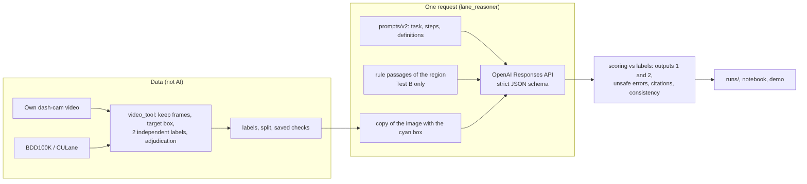

# Reasoning Driving

EGN 6216 AI Systems, Fall 2026. Jiahao Pang, University of Florida.

Research question: does the local traffic-rule text help a multimodal LLM read lane markings in different regions?

Lane markings mean different things in different countries, and a lane detector only finds where the lines are, not what they allow. This project asks a multimodal model (OpenAI `gpt-6.1-sol`) what one marked lane marking in a dash-cam photo allows a car to do. Each image is asked twice: Test A with the image only, and Test B with the image plus the rule passages of the photo's region (MUTCD for the US, GB 5768.3-2025 for China). Everything else is the same, so the difference shows what the rule text adds. No region-specific model is trained, and the answers cite the rule they use, so they can be checked.

## Status

| Stage | Status | Where |
|---|---|---|
| Data collection | BDD100K validation split and CULane test split as candidate pools (only a small labeled sample is used), MUTCD Part 3, GB 5768.3-2025 | [`playground.ipynb`](playground.ipynb), [docs/data_collection.md](docs/data_collection.md) |
| Rule pack | 30 passages (16 US, 14 CN) | `rules/rule_passages.json`, `config/action_rules.json` |
| Labels | 40 images from one US night drive; BDD100K and CULane in progress | [`video_tool`](docs/labeling_tool.md), `labels/` |
| Splits | v1 and v2, with separation checks | `labels/split_v*.csv`, `labels/split_check_v*.json` |
| Model runs | 6 runs on development images (prompts v1, v2, v3; Test A and B) | [`model_exploration.ipynb`](model_exploration.ipynb), `runs/` |
| Demo | browser page for single images and runs | `python -m lane_reasoner demo` |
| Test set | not run yet | |

## Results so far (development images, preliminary)

40 development images from one US night drive, each asked 3 times; the majority answer is scored. Output 2 counts only the actions the label decides, without contested rule-table cells (37 images).

| Run | Configuration | Output 1 (marking) | Output 2 (actions) | Unsafe errors | Inconsistent answers | Same answer in all 3 repeats | Cost |
|---|---|---|---|---|---|---|---|
| 1 | Test A, prompt v1 (initial) | 40/40 | 36/37 | 1 | 6 | 82.5% | $0.51 |
| 2 | Test B, prompt v1 (targeted change: rule passages added) | 39/40 | 35/37 | 0 | 7 | 80.0% | $0.77 |
| 3 | Test A, prompt v2 | 39/40 | 35/37 | 1 | 0 | 90.0% | $0.82 |
| 4 | Test B, prompt v2 | 40/40 | 36/37 | 0 | 0 | 97.5% | $1.22 |
| 5 | Test A, prompt v3 (reasoning before the decision) | 40/40 | 34/37 | 3 | 0 | 92.5% | $1.00 |
| 6 | Test B, prompt v3 | 39/40 | 34/37 | 2 | 0 | 95.0% | $1.38 |

Run IDs: `20261027_021643_testA_US`, `20261027_021740_testB_US`, `20261027_021835_testA_US`, `20261027_021957_testB_US` (Milestone 4), `20261027_221432_testA_US`, `20261027_221432_testB_US` (v3). Mean latency 4.1 to 5.0 s per request (p95 7.3 to 8.0 s).

* The rule text removed the unsafe error (a single solid yellow left-edge line: Test A allows crossing, Test B cites MUTCD 3B.09 ¶03 and prohibits it). Accuracy did not change: exact McNemar p = 1.0 for every pair of runs.
* Prompt v2 removed the self-contradicting answers and made the three repeats agree more often, at the same accuracy.
* Prompt v3 makes the reasoning visible but did not improve accuracy (v2 to v3: Output 2 from 35 to 34 in Test A, from 36 to 34 in Test B; exact McNemar p = 1.0 and 0.5). The traces show why: on yellow left-edge lines the model combines the task convention "an action that is only discouraged counts as allowed" with the general passage 3A.04-01 ("a solid line discourages or prohibits crossing") instead of the specific passage 3B.09-03, and answers that crossing is allowed. Each request costs about 15 to 20% more.
* Open cases: the faint edge line `f0008220` (possible label error) and the contested U-turn from a left-turn lane.
* The images are easy, come from one drive and from the region the model knows best, so A and B can hardly differ yet.

Details, error cases and the reasons for each change are in [`model_exploration.ipynb`](model_exploration.ipynb).

## Reproduce

Tested on macOS (Apple silicon) with Python 3.11 and on Linux with Python 3.10 and 3.13.

### 1. Install and run the self-tests

```bash
git clone https://github.com/Jonas-Pang/Reasoning-drive.git && cd Reasoning-drive
conda create -n reasoning-driving -c conda-forge --override-channels python=3.11 -y
conda activate reasoning-driving
pip install -r requirements.txt

python -m video_tool selftest       # labeling tool, 32 checks
python -m lane_reasoner selftest    # settings, prompts, scoring, runs, trace, demo, 45 checks
```

Recompute the results table from the saved runs:

```bash
python -m lane_reasoner table 20261027_021643_testA_US 20261027_021740_testB_US 20261027_021835_testA_US 20261027_021957_testB_US
python -m lane_reasoner compare 20261027_021643_testA_US 20261027_021740_testB_US
```

### 2. Set your OpenAI API key

```bash
cp .env.example .env
```

Open `.env` and set `OPENAI_API_KEY=` to your own key (Section 1 of `experiment.ipynb` can also write it for you). `.env` is listed in `.gitignore`. Then check the key and the model:

```bash
python -m lane_reasoner ping --real
```

### 3. Get the data

Run all cells of `playground.ipynb`. It downloads BDD100K and MUTCD, checks the five CULane archives (download them in the browser from the official page; the notebook names the files) and unpacks everything. Then compare your files with `data_hashes.csv`:

```bash
python -m video_tool hash-sources
```

Set `DATA_DIR` in `.env` if the data is not in `data/`.

### 4. Label images

One workspace folder per collection under one root folder; set `DATASETS_ROOT=<root>` in `.env`.

```bash
python -m video_tool --data "<root>/bdd100k" images init bdd100k
python -m video_tool --data "<root>/culane"  images init culane
python -m video_tool --data "<root>/bdd100k" label
python -m video_tool combine "<root>/UF" "<root>/bdd100k" "<root>/culane"
```

`combine` writes the labels, the split and the separation check to `labels/`. Own dash-cam videos go through `video_tool ingest`, `scan` and `label`. The procedure is described in [docs/labeling_tool.md](docs/labeling_tool.md).

### 5. Run the model

```bash
python -m lane_reasoner ask <image_id> --real                          # one image, reasoning printed step by step
python -m lane_reasoner run --test AB --split dev --repeats 3 --real   # add --trace to print every answer's reasoning
python -m lane_reasoner trace <run_id>                                 # reasoning of a saved run
python -m lane_reasoner demo
```

or run all cells of `model_exploration.ipynb`. All settings are in `config/experiment.yaml` (see *Configuration*).

## Configuration

Everything that defines an experiment is in one file, `config/experiment.yaml`:

```yaml
experiment:
  region: US          # whose images and rules
  use_rules: no       # no = Test A (image only); yes = Test B (image + rules)
  prompt: v3          # folder under prompts/
  split: dev
  repeats: 1
  mock: true          # true = no API calls
model:
  name: gpt-6.1-sol
  api_key_env: OPENAI_API_KEY   # the key itself is in .env
  reasoning_effort: low
  reasoning_summary: off        # auto = also return the model's summary of its hidden reasoning
data:
  workspaces: [UF, bdd100k, culane]
  send_to_api: [own_video]
regions:
  US:
    name: the United States
    rules: {file: rules/rule_passages.json, code: US, title: "MUTCD 11th Edition ...", language: en}
```

The full file has comments for every setting. The command line options (`--test`, `--region`, `--split`, `--repeats`, `--real`) override it for one run.

The demo page reads the file when it starts. Its controls (Test A/B, region, mock or real) and the settings dialog (model, prompt version, reasoning effort and summary, image detail, output limit, parallel requests) change the settings of the open page only. The dialog lists the settings that differ from the file; ticking "save as default" writes them into `config/experiment.yaml`, changing only those values and keeping the comments. "Reload from file" reads the file again, for example after editing it by hand.

### API

The model and request settings are under `model`. The key is read from the environment variable named in `api_key_env` (default `OPENAI_API_KEY`), set in `.env`.

### Prompts

Each prompt version is a folder under `prompts/`. Version v3 is split by purpose:

| File | Content |
|---|---|
| `role.txt` | who the model is and which marking it judges |
| `procedure.txt` | how it processes the photo: look, rule, decide, check |
| `step2_A.txt`, `step2_B.txt` | step 2 without rules (Test A) and with the rule passages (Test B) |
| `fields.txt` | how to fill in each answer field; definitions of marking types and actions |
| `citation_A.txt`, `citation_B.txt` | how to fill in `cited_rule_id` |
| `rules_header.txt` | heading of the rule block (Test B) |
| `user.txt` | the input message sent with the photo |
| `answer_fields.txt` | order of the answer fields |

`python -m lane_reasoner prompt --test B` prints the full prompt as it is sent.

### Reasoning before the decision

In v3 the model writes its answer in this order: what it sees (`description`, `evidence`, `marking`), which rule applies (`rule_reasoning`, `cited_rule_id`), one reason per action (`action_reasons`), a check (`self_check`), and only then the decision (`actions`). The decision therefore follows from the steps before it. `ask`, `run --trace`, `trace` and `runs/<run_id>/trace.md` print these steps for every answer, with the label and the cost. With `reasoning_summary: auto` the trace also shows the model's own summary of its hidden reasoning (the API returns a summary, not the hidden tokens).

### A new country or regulation

1. Put the passages in a file in `rules/` (JSON or YAML list); each passage has `rule_id`, `region`, `source`, `section`, `page`, `marking_type`, `text_en` and the original text.
2. Add the country under `regions` in `config/experiment.yaml`: `name`, and under `rules` the `file`, `code`, `title` and `language` (`en`, `zh` or `both`).
3. Add its rows to the rule table `config/action_rules.json`, which keeps the labels consistent.
4. Label its images (next section) and set `experiment.region` to the new code. Set `use_rules: yes` for Test B.

### New images

Images enter through labeling workspaces made with `video_tool`: `video_tool ingest` for own dash-cam videos, `video_tool images init bdd100k|culane` for the two datasets. A workspace listed under `data.workspaces` is read for its final labels, and its images are sent to the API only if its collection is in `data.send_to_api`. Another public dataset needs a reader in `video_tool/imagesets.py`.

## How the system works



| Part | AI? | What it does | How it is tested |
|---|---|---|---|
| Frame keeping, target box, labels | no | people label marking type, visibility, six actions and accepted rule IDs; a rule table fills in consistent defaults | agreement (Fleiss κ), adjudication, label checker |
| Prompt builder | no | fixed templates plus the region's passages (Test B) | self-test: Test A has no passage, Test B has exactly the region's passages |
| Image preparation | no | draws the cyan box on a copy and encodes it as JPEG | self-test |
| Model | yes | interprets the marking: type, arrow directions, position, evidence level, six actions, cited passage | model runs |
| Parser and schema | no | strict JSON schema; unreadable answers are counted, not repaired | self-test |
| Scoring | no | compares with the labels; contested cells kept separate; McNemar test | self-test |
| Policy, retries, cache | no | sends only permitted collections; retries on 429 and 5xx; caches identical requests | self-test with a fake API server |

The answer fields of prompt v3, in the order the model writes them, are `description`, `evidence` (full, partial or insufficient), `marking` (Output 1: type, arrow type, position), `rule_reasoning`, `cited_rule_id` (Test B), `action_reasons`, `self_check` and `actions` (Output 2: cross line, go straight, turn left, turn right, U-turn, enter centre lane; each allowed, prohibited, not_determined or not_applicable). In v1 and v2 the fields are `description`, `evidence`, `marking`, `actions`, `cited_rule_id` and `reasoning`.

### Prompt versions

| Version | What it is | Runs | Result |
|---|---|---|---|
| v1 | The first prompt: one instructions file with three steps (describe, match a rule, decide); the reasoning is written after the actions | 1, 2 | 6 to 7 answers per run contradict themselves; repeats agree on 80 to 82% of images |
| v2 | v1 corrected after its errors on development images: describe only visible features, which actions each marking type governs, `not_determined` only with partial evidence, a self-check step, and in Test B "use the passages, not memory" | 3, 4 | no contradictions; repeats agree on 90 to 97.5%; same accuracy |
| v3 | v2 split into files by purpose; each reasoning step is an answer field written before the actions | 5, 6 | reasoning visible in every answer; one or two more errors (see *Results so far*) |

Each folder has a README with the details ([v1](prompts/v1/README.md), [v2](prompts/v2/README.md), [v3](prompts/v3/README.md)).

### Measures against unsupported answers

* The model describes what it sees before it decides (v3: as separate fields before the actions).
* The answer must match a strict schema with fixed values, so it cannot invent categories.
* The evidence level lets the model say that the photo does not show enough, instead of guessing.
* Test B may cite only the listed passage IDs; the scoring checks each citation.
* Repeated requests show how stable the answers are, and the majority answer is scored.
* A consistency check that needs no labels (`scoring.consistency_issues`) counts answers that contradict themselves.

### Metrics

* Output 2 exact match (main metric), unsafe errors (label prohibits, model allows), and precision, recall and F1 of "prohibited" over all (image, action) pairs.
* Output 1 accuracy, per-class precision, recall and F1, macro-F1, confusion matrix.
* Evidence groups, citations, confidently wrong answers, inconsistent answers.
* Repeatability, readable answers, latency, tokens and cost.
* Exact McNemar test on paired images.

## Data, labels and splits

### Sources

| Source | Content | Licence |
|---|---|---|
| BDD100K (Dataset Ninja mirror of the official release) | validation split (10,000 images, US): candidate pool | educational, research and non-profit use; keep the copyright notice |
| CULane | test split (34,680 frames, China): candidate pool | non-commercial research and teaching; no redistribution |
| MUTCD 11th Edition, Part 3 | US marking rules | U.S. government work |
| GB 5768.3-2025 | Chinese marking rules | free to read; short quotes only |

Origin, size, SHA-256 and MD5 of every download are in `data_manifest.csv` and `data_hashes.csv`.

### How much of each dataset is used

The BDD100K validation split and the CULane test split are downloaded in full only so that suitable images can be found. `video_tool images init` indexes every image as a candidate with hints from the dataset's own labels (lane type, scene category, time of day), and images are then picked by hand into quota cells. The planned sample, per marking type and region, is 6 development images and 30 test images, plus 30 degraded test images per region: about 350 labeled images in total, own videos included. Only labeled images are scored, and only images of collections listed in `data.send_to_api` are sent to the model. So far 5 BDD100K images are picked and none of BDD100K or CULane is labeled; `labels/candidate_supply.csv` shows how many candidates each pool offers.

### Labels

142 frames were kept from one night drive in Florida; 40 have a final label. Each was labeled by two annotators independently, and disagreements were adjudicated. Agreement before adjudication (Fleiss κ, 43 frames): marking type 1.00, arrow type 1.00, position 0.92, visibility 0.79, cross line 0.96, turn left 0.95, other actions 1.00 (`labels/own_video/agreement.csv`).

Labeled examples per type (`labels/coverage_v2.csv`, US development set): yellow double solid 15, white dashed 7, left arrow 5, yellow solid 4, straight arrow 3, two-way left-turn lane 2, other 2, white solid 1, straight-and-left arrow 1, all from one drive. Candidates that the datasets can still supply are in `labels/candidate_supply.csv`.

Supported arrow types: left and straight for the US (BDD100K has no arrow labels, so US arrows come from own videos). Chinese arrow types are decided after the CULane arrow frames are labeled. A type with fewer than 15 clip-separated test images is reported separately or dropped.

### Splits (6.5)

A clip goes to the development set if `sha1("6216:"+clip) mod 10 = 0`, otherwise to the test pool. The own drive was moved from test to development after it was used to build the prompts; the move and its reason are in `labels/split_changes.csv`, and both versions are kept (`split_v1.csv`, `split_v2.csv`). Each `split_check_v<N>.json` records clips on both sides (0), near-duplicate development/test pairs (0, dHash within 4 bits) and prompt examples not from development images (0).

## Data sent to the API

Each request sends one JPEG copy of the image with the target box, the instructions and, in Test B, the region's rule passages to the OpenAI Responses API, with `store: false`. Labels and file names are not sent. See [OpenAI: Your data](https://developers.openai.com/api/docs/guides/your-data) for retention.

`data.send_to_api` in `config/experiment.yaml` lists the collections whose images may be sent (default: `own_video`). Add `bdd100k` or `culane` only with the dataset owners' permission; see [docs/permission_requests.md](docs/permission_requests.md).

## What the results can and cannot claim

* Pretraining exposure may interact with the rule text. If the model has seen the public images or memorised the MUTCD, Test A is already high and Test B can add little, and this differs between regions. The own videos were never public, which allows a within-US comparison with BDD100K.
* Region is confounded with camera, image date, rule edition, translation (the Chinese passages are an English translation) and image selection. A larger gain in China would not show that the model "understands Chinese rules worse".
* Claims are kept narrow: on these images, with these passages and this prompt, adding the passages changed Output 2 by X and unsafe errors by Y. Results are reported per source and per region.
* Labels can be wrong. Disagreements between model and label are reviewed blind, label errors are corrected and logged, and scores are reported before and after the review.

## Who could use this

* Teams bringing a driver-assistance function to a new country: which marking types a vision-language model misreads there, whether the local standard helps, and which errors are unsafe.
* Map and annotation teams: pre-labels of what each marking allows, with a citation to the standard, for a person to confirm.
* Researchers: a protocol with rule-ID labels, a rule pack per region, a paired A/B design and metrics for unsafe errors and hallucination.

It is not a driving controller: one answer takes 4 to 8 seconds.

## Extending to other countries

The steps are in *Configuration*. Left-hand traffic (UK, Japan, Australia) needs action definitions that depend on the driving side, and marking types outside the schema (UK zig-zag lines, Chinese left-turn waiting areas, temporary yellow work-zone markings) need new schema values.

## Response to the Milestone 3 feedback

| Feedback | Done | Where |
|---|---|---|
| Project-specific labeled data, usable counts, label uncertainty, supported arrow types | 40 final labels with two annotators and adjudication; κ per field; counts per type with clip counts; arrow types decided | `labels/own_video/`, `labels/coverage_v2.csv`, *Data, labels and splits* |
| Saved separation check, `split_v1.csv`, development-side decisions, moved clips recorded | split v1 and v2 with checks; the move logged with its reason | `labels/split_*`, `labels/split_check_v*.json`, `labels/split_changes.csv` |
| Hashes of manual downloads and mirrors; permission for external processing; data transfer to the API | SHA-256 and MD5 for all downloads; dataset images blocked from the API until permission; transfer stated | `data_manifest.csv`, `data_hashes.csv`, `config/experiment.yaml`, *Data sent to the API* |
| Pretraining exposure, regional confounds, specific claims | stated, with planned controls | *What the results can and cannot claim* |
| Clip-separated examples per type and region | US: one clip per type so far; China: none yet | *Data, labels and splits* |

## Changes since Milestone 3

* Model `gpt-6.1-sol` (planned: `gpt-6-sol`), `reasoning_effort: "low"` (`"none"` is rejected), no `temperature` (not accepted; variation is measured with three repeats), `max_output_tokens` 2000.
* Development set: the own pilot drive.
* Prompt v2 replaced v1 after runs 1 and 2; both are kept.
* After Milestone 4: settings in one YAML file, prompt v3 (reasoning written before the decision), a reasoning trace for every answer, and runs 5 and 6 with v3.
* Cost per request: $0.0064 to $0.0069 (Test A) and $0.0096 to $0.0101 (Test B). A final comparison (300 images, 2 tests, 3 repeats) is estimated at about 29 minutes and $15.

## Planned work

1. Blind review of the model–label disagreements (`f0008220`, contested U-turn cell).
2. Finish labeling the pilot drive (4 conflicts, 98 frames without a target box).
3. Permission from the BDD100K and CULane owners to send images to the API.
4. Development labels for China (CULane arrow frames) and for BDD100K.
5. More own drives on other routes and in daylight.
6. Fixed text examples written from a separate pool of development images.
7. A targeted change for the v3 error: in Test B, prefer the passage for the specific marking over a general one, and state the "discouraged counts as allowed" convention more narrowly; then run v3 again.
8. Controls: Chinese original versus English translation; own video versus BDD100K.
9. A `driving_side` field for left-hand traffic; passage selection for long standards.
10. Freeze the prompt and the scoring criteria, label the test set and run it once.

## Repository layout

```
Reasoning-drive/
├─ model_exploration.ipynb    Milestone 4: first model exploration
├─ experiment.ipynb           API key, prompts, smoke test, demo, batch runs
├─ playground.ipynb           data download and checks
├─ docs/                      data_collection.md, labeling_tool.md, model_runs.md, permission_requests.md, pipeline diagram
├─ config/                    experiment.yaml (all settings), label_schema.json, action_rules.json, rule_translations_zh.json, data_sources.json
├─ rules/rule_passages.json   rule passages (16 US, 14 CN)
├─ prompts/v1/ ... v3/        prompt files of Test A and Test B
├─ labels/                    labels, splits, separation checks, coverage
├─ runs/<run_id>/             manifest.json, results.jsonl, scores.json, summary.md
├─ lane_reasoner/             settings, prompts, API client, scoring, runs, trace, report, demo, CLI, self-test
├─ video_tool/                labeling tool for videos and dataset images
├─ data_manifest.csv, data_hashes.csv
└─ requirements.txt, .env.example
```

More detail: [docs/model_runs.md](docs/model_runs.md), [docs/labeling_tool.md](docs/labeling_tool.md), [docs/data_collection.md](docs/data_collection.md).
